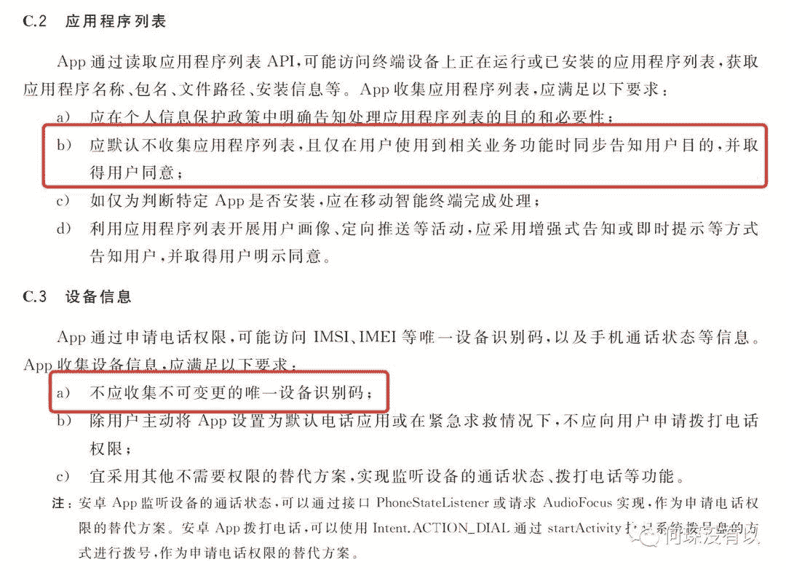

# App收集个人信息基本要求的相关要求理解

> 来源：[https://docs.feishu.cn/docx/Y1vGd8U8BoHrPzxXtywctD5jn7e](https://docs.feishu.cn/docx/Y1vGd8U8BoHrPzxXtywctD5jn7e)

**-问：**下图要求应该如何落实？

**-答1：**基于**风控功能**收集安装应用列表是基本需求，不知道国标怎么没有考虑这点。

**-答2：**不让收集IMEI也很麻烦。

**-答3：**唯一标识符**太敏感**，现在有**GUID OUID****之类的代替方案。现**在唯一标识符就需要signature权限才能拿，只有终端厂商自己的应用才能拿到，互联网应用申请不到这个权限，安卓就是这么搞的。iOS也是一直不给的。

**-答4：****目前人行，市场**监督管理局在例行场检，约谈中，都针对消费者权益保护，提到IMEI权限的问题了。一般都不让收集。除非有监管规定明确要求提供IP、MAC、IMEI等信息，银行、证券行业都是有相关要求的。

[APP](https://cbe8t1r4a5.feishu.cn/wiki/wikcnm7SSi199OdP5q0UAot3Fsf)