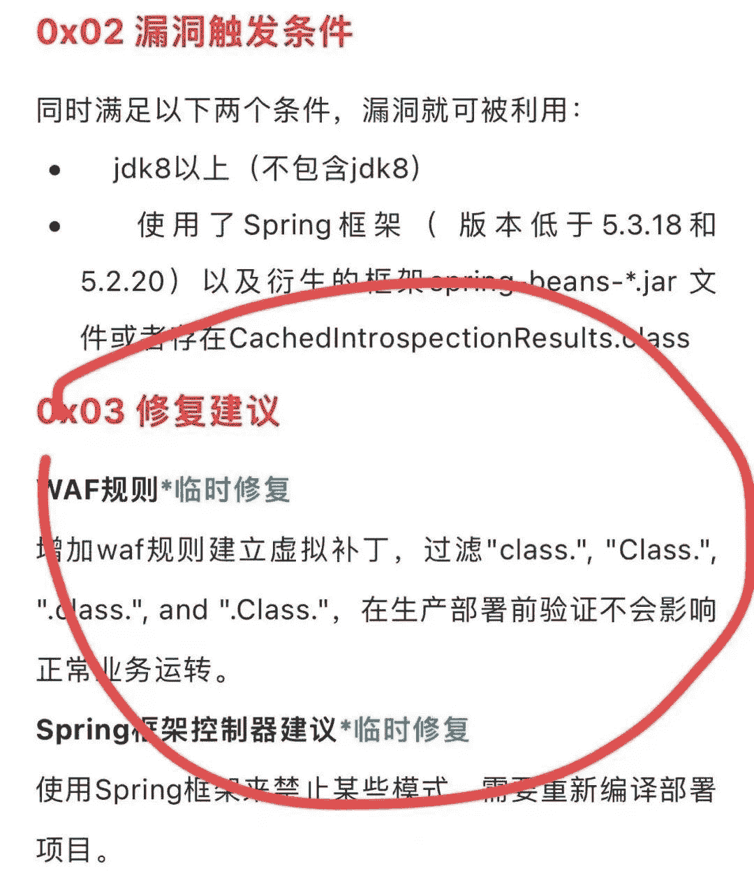

# APP安全扫描的数据流

> 来源：[https://docs.feishu.cn/docx/L8Oadx0TpoKHZ7x514gcWGEHnfc](https://docs.feishu.cn/docx/L8Oadx0TpoKHZ7x514gcWGEHnfc)

**-问：**远程对系统做安全扫描数据是怎么流动的？系统向扫描仪器所在服务器发送了什么数据？以及扫描仪器向系统发送了什么数据呢？

**-答1：**传送的数据和个人信息保护没关系啊。而且我们不会用远程2个字。我们会说通过外网对系统做安全扫描。

**-追问：**不过我需要知道哪些数据在这个过程被传输了？

**-答2：**不管是安全人员还是外部黑客，都是在开锁，所以就是很正常的在门外撬锁。

**-答3：****代码**被传输。你搜搜黑鸭，自己看看。

**-答4：**如果没有漏洞，你可以理解为，对着一个金钟罩高手拼命点穴，通常[情况下屁反应都没。相当于对系统传输代码，系统接收代码，但是被各](https://mp.weixin.qq.com/s?__biz=MzkwNzI0MTExNQ==&mid=2247484514&idx=1&sn=776594d7efdbd5dadb1ecba8e5ceb8da&scene=21#wechat_redirect)种安全设备拦截了。所以很多扫描连系统的毛都没碰到。参见这个漏洞：【漏洞分析】 CVE-2022-22965-Spring漏洞（Spring4Shell）分析及修复方法

红色圈起来的就是安全设备WAF，你的扫描发起，经过WAF，就通过规则被识别恶意扫描。拦截了。所以要靠扫描获取系统信息很难。你能拿到有用的信息，很可能系统已经被攻下了。

**安全扫描容易出现的问**题就是是否涉及破坏计算机系统等罪名。所以安全厂商做扫描，行规就是必须甲方签字同意发起扫描。乙方可以承诺不对甲方系统完成破坏。但是甲方得确认扫描是得到甲方授权的。

[APP](https://cbe8t1r4a5.feishu.cn/wiki/wikcnm7SSi199OdP5q0UAot3Fsf)