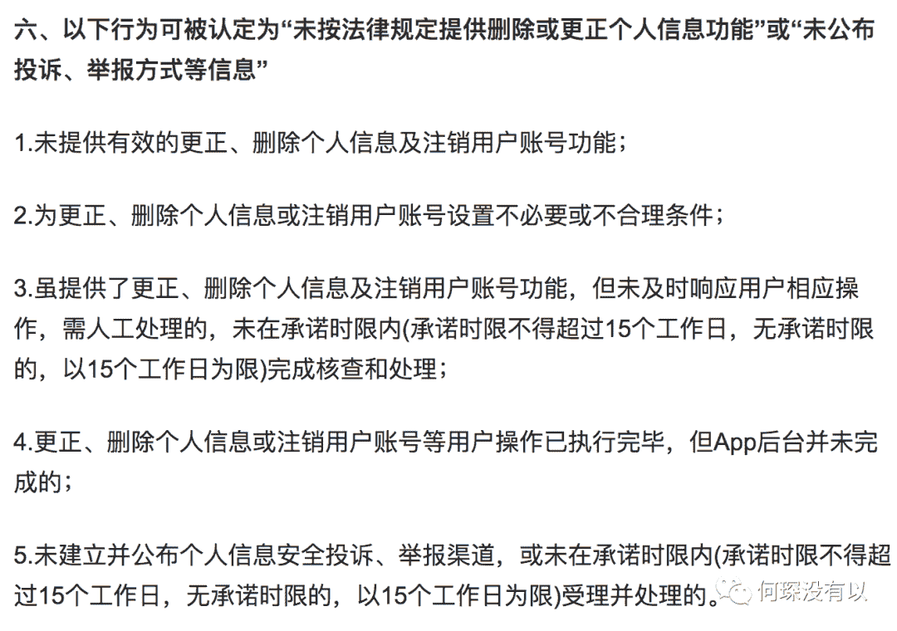

# 用户注销功能的设置

> 来源：[https://docs.feishu.cn/docx/Rb3odNlIVoK8YMxZWCSc6fJ7n1b](https://docs.feishu.cn/docx/Rb3odNlIVoK8YMxZWCSc6fJ7n1b)

**-问：**就是如果我在app有数据删除-注销功能，但是就放了个客服电话，让用户打电话注销，算不算满足appstore要求。找苹果客服，客服都很懵圈。

**-答1：**注销，基本上没有另行规定的，都**要支持线上注销**。但是注销，对于仅有一个大账户，多个产品，这种形态非常不利。

**-答2：**参考《App违法违规收集使用个人信息行为认定方法》

**-答5：****粤通管**两年前就不让了，继续**产品内注销**，不能留个电话。

**-追问：****to B**的APP也要有这个要求吗？比如说，客户公司指定当时授权的员工注册一个账号，万一他离职的时候自己直接把账号注销了，那太麻烦了。

**-答6：**首先，to B的APP最好**不要上架**。其次，这种情况可以考虑建立企业账户，相关信息是企业的信息，而非员工的。

[APP](https://cbe8t1r4a5.feishu.cn/wiki/wikcnm7SSi199OdP5q0UAot3Fsf)

[账户注册/注销](https://cbe8t1r4a5.feishu.cn/wiki/wikcn7NWTsw2CDopTUC6JtHBRyf)