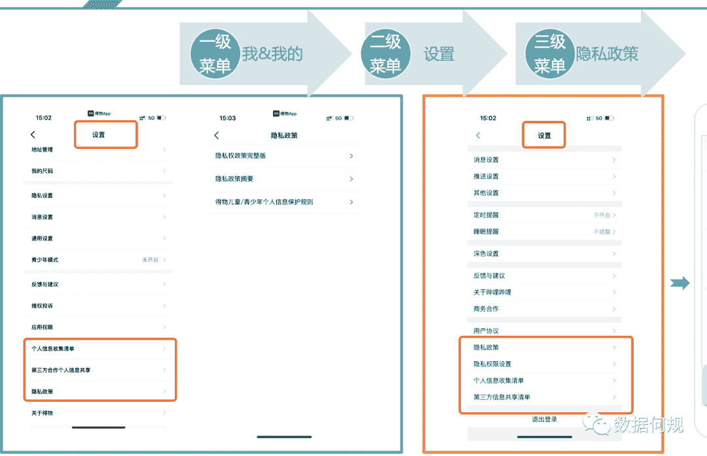

# 不同告知文本放在几级菜单

> 来源：[https://docs.feishu.cn/docx/KbNTdMadcoWldkxBsLyc1yFjnGf](https://docs.feishu.cn/docx/KbNTdMadcoWldkxBsLyc1yFjnGf)

**-问：**现在关于哪些功能应在几级菜单 这个有明文规定了吗？

**-答1：**隐私政策点**4次**，双清单放在**二级菜单**。

**-答2：**可参考下图。

[APP](https://cbe8t1r4a5.feishu.cn/wiki/wikcnm7SSi199OdP5q0UAot3Fsf)