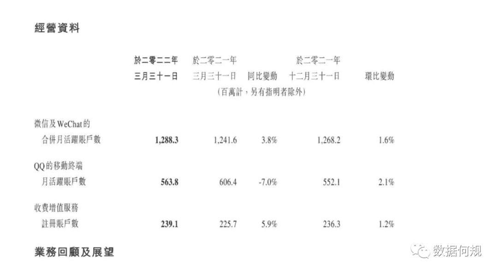

# 年度活跃用户怎么算

> 来源：[https://docs.feishu.cn/docx/VlGkdfKw8oG0c7xWVloc1teonxe](https://docs.feishu.cn/docx/VlGkdfKw8oG0c7xWVloc1teonxe)

**-问**：年度活跃用户在哪里可以查吗，有没有比较官方的统计方法呀，以及这个数据一般和月度活跃用户的关系是怎样呀。

**-答1：**YUA就是指一年内使用过的用户吧。

**-答2：**这种数据一般是自行发布吧，如果有上市可以看看年报。年活（YAU）这个指标很少见，一般是日活（DAU）和月活(MAU)居多。

**-答3：**可以看看QUSETMBOILE、艾瑞咨询、七麦、点点数据、TrustData等数据网站。

**-答4：**YAU=∑MAU并去重；MAU=∑DAU并去重；所以理论上YAU≥MAU≥DAU，所以如果只找到了MAU的指标，YAU肯定也超过了。

**-答5：**在融资、宣传时，这些数据往往是越高越好，但未来对于大平台科以的监管义务也是更高的，这个点会很有意思。

[APP](https://cbe8t1r4a5.feishu.cn/wiki/wikcnm7SSi199OdP5q0UAot3Fsf)