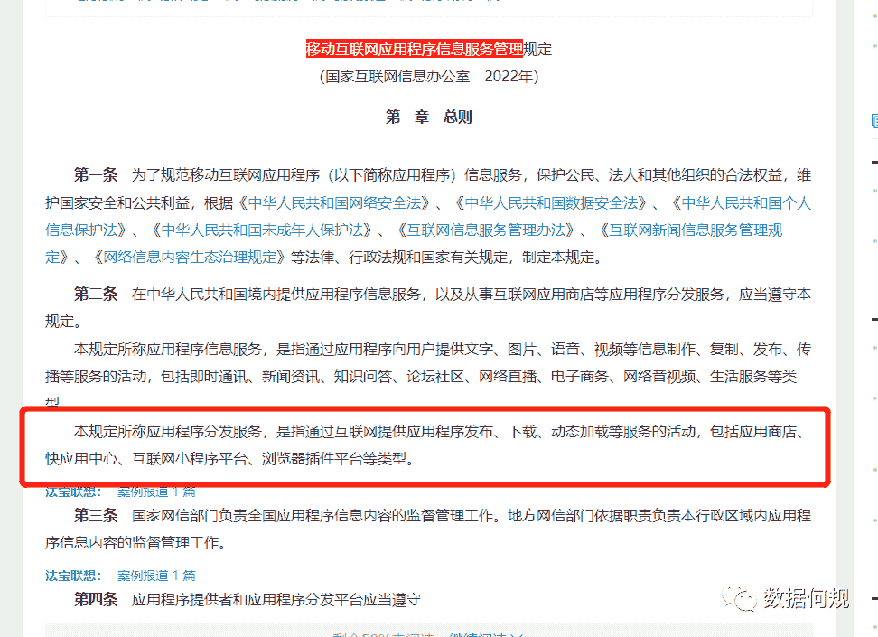
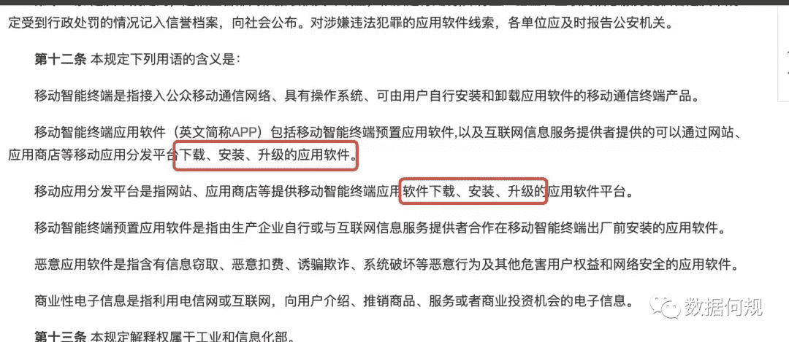
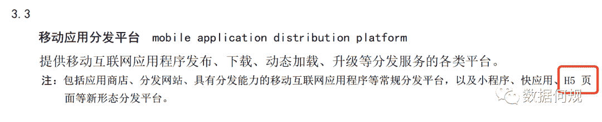

# H5页面算分发平台吗

> 来源：[https://docs.feishu.cn/docx/Yud1d4boOo9D7UxyfCCcDANhnqb](https://docs.feishu.cn/docx/Yud1d4boOo9D7UxyfCCcDANhnqb)

**-问：**打开第三方H5游戏，算应用分发行为么？根据网信办这个文感觉属于应用分发。

根据工信部这个《移动智能终端应用软件预置和分发管理暂行规定》可能不算。

**-答1：**新**鲜出炉的团标《APP用户权**益保护测评规范 第9部分：移动应用分发平台信息展示（T/TAF 078.9—2023）》明确列举了 H5属于应用分发平台新形态。

[APP](https://cbe8t1r4a5.feishu.cn/wiki/wikcnm7SSi199OdP5q0UAot3Fsf)