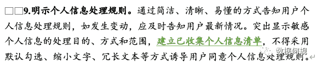
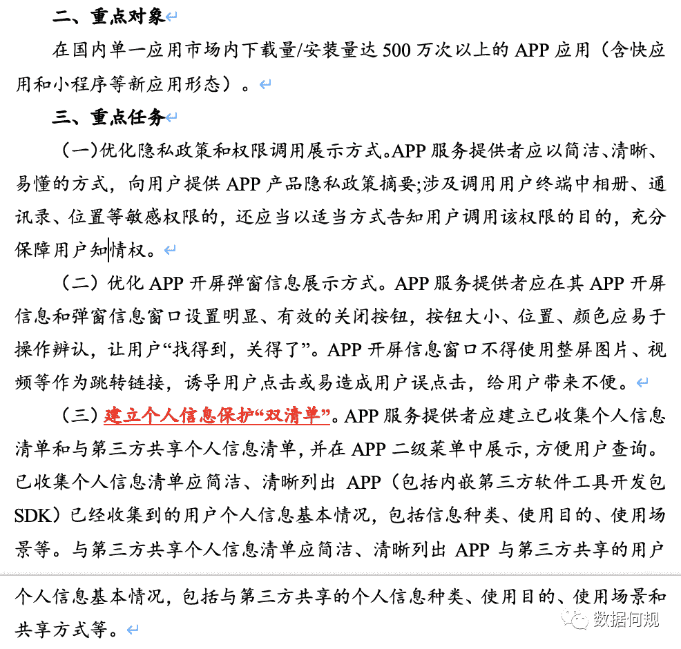

# 双清单是必需的吗

> 来源：[https://docs.feishu.cn/docx/Wn7MdURdxoyCy0xt1xZcmzjmnlg](https://docs.feishu.cn/docx/Wn7MdURdxoyCy0xt1xZcmzjmnlg)

**-问：**现在APP检测哦，机构对双清单意见是必须得有，对吗？

**-答1：**看看这个的要求工信部印发进一步提升移动互联网应用服务能力的通知。524只要求头部，但3月的26号文要求都做已收集个人信息清单。

**-答2：**对的，而且检测机构已经按照今年26号文做检测了。

**-答3：**[上海通管局对超过500万下载量的](https://mp.weixin.qq.com/s?__biz=MzAwOTYxNTU5Nw==&mid=2649884044&idx=3&sn=4ccc172771d7a56bcc1dd3219fe2a985&scene=21#wechat_redirect)APP也要求双清单了。详见：上海市通信管理局关于纵深推进移动互联网领域信息通信服务感知提升行动的通知。

[APP](https://cbe8t1r4a5.feishu.cn/wiki/wikcnm7SSi199OdP5q0UAot3Fsf)