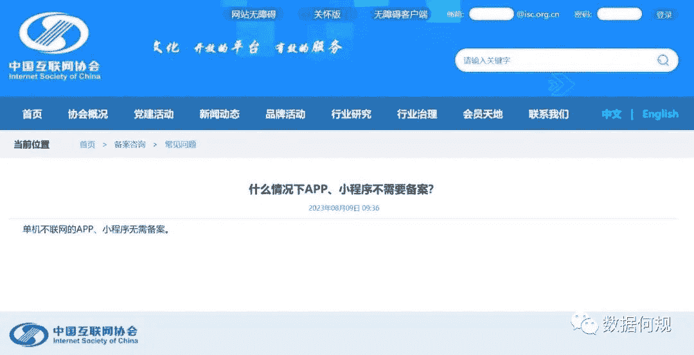

# Testflight测试版APP要备案吗

> 来源：[https://docs.feishu.cn/docx/Vvm9dbxipoL0xdxfixncTpqVnhb](https://docs.feishu.cn/docx/Vvm9dbxipoL0xdxfixncTpqVnhb)

**-问：**基于昨天APP备案新规，在Apple里通过Testflight发布的测试版，上线前是否需要备案？未在安卓市场上架的apk安装包，是不是也需要备案？

**-答1：**我个人觉得他和在哪儿发布没啥关系，testflight可能可以豁免一下。

**-答2：**感觉至少是安卓都需要备案，并在系统的中明确位置上做提示。

**-答3：**tf是测试环境。

**-答4：**应用商店角度，感觉会从严，这个是不是取决于各个商店注册开发者的时候需要提交的资质，如果注册开发者的时候就需要公司资质和icp。那是不是测试环境感觉也无所谓了。（没了解过上架应用商店需要的信息，只是突然想到的）

**-答5：**测试管不到，但是测试全是涉黄涉赌。

**-答6：**互联网协会有个问答。

[**总结：可能还是要，联网**](http://mp.weixin.qq.com/s?__biz=MzU1MzAzNzcwNw==&mid=2247487998&idx=1&sn=ddbc60ecb4248e64803bcdb820d05c8e&chksm=fbf9ab1acc8e220cf3fd9a66fe8f3eca8b57cf5c34b87cb05c70f18271137a94fe339689c29e&scene=21#wechat_redirect)**就**要，备案汇总可以看这篇：应用ICP备案信息汇总。

[APP](https://cbe8t1r4a5.feishu.cn/wiki/wikcnm7SSi199OdP5q0UAot3Fsf)