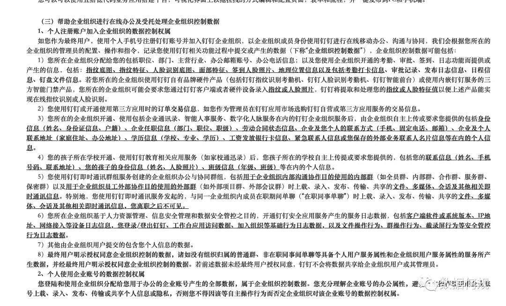

# SaaS企业办公APP的运营者

> 来源：[https://docs.feishu.cn/docx/KdNFd7gYeo3rONxdo8YcnkDCnhf](https://docs.feishu.cn/docx/KdNFd7gYeo3rONxdo8YcnkDCnhf)

**-问：**请教一个问题：办公协同APP 平台给某个企业专门做一个定制版，该企业集团直接部署给全部员工。定制版隐私政策明确是这个企业运营APP并提供服务。那么，怎么来认定，谁是个人信息处理者（controller）？根据隐私政策直接认定呢，还是根据实际的运营情况，穿透来认定？SaaS 服务，前端是 APP。要求全体员工都要安装。勾选同意的隐私政策，也是定制版隐私政策，即由这个企业，而非平台，运营并提供服务。

**-答1：**私有化部署的话，其实背后的APP平台无法获取所收集到的数据了。我了解到的私有化部署一般是收集到的数据放在使用该软件的企业服务器而非软件服务提供方，当然软件服务提供方作为受托处理我认为是没有异议的。私有化部署，SaaS平台方一样访问、存数据的。

**-答2：**SaaS平台是受托处理数据吧，可以获取的。类似威胜公司很多企微的SaaS产品。

**-答3：**我理解提供软件这个服务的是processor，使用这个软件服务并进行本地化部署为员工提供服务的是controller。

**-答4：****企业是控制者  服务方是处理者**。和钉钉差不多。

总结：谁决定处理目的，谁就是controller。

[委托处理](https://cbe8t1r4a5.feishu.cn/wiki/wikcnNszO9ekChKQOUXF76MHUEb)

[APP](https://cbe8t1r4a5.feishu.cn/wiki/wikcnm7SSi199OdP5q0UAot3Fsf)