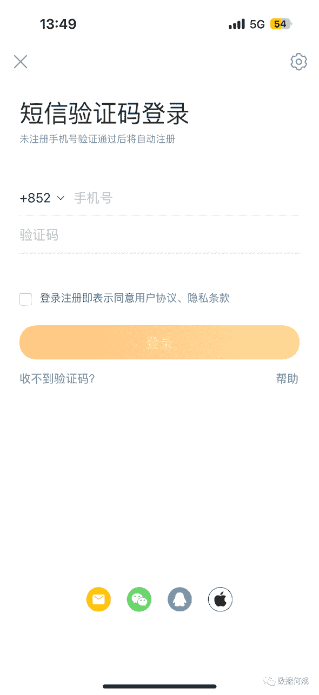

# 境外号码注册境内APP

> 来源：[https://docs.feishu.cn/docx/UmfydAWfho148KxlzaqcliX9ny1](https://docs.feishu.cn/docx/UmfydAWfho148KxlzaqcliX9ny1)

**-问：**海外的手机号可以注册境内APP账户吗，如果可以注册，算是落实了账户实名制的要求吗。有无相关APP案例可以借鉴呀？我看微博是可以直接注册海外手机号的。不知道进入之后，会不会有啥别的实名制要求。

**-答1：****微信注册可以，但是支付好像不行**。

**-答2：**你说的到一个法律的盲点，按照国内的政策法规，这是形式上实现了实名制，但是国外的账号并不是实名，所以本质上应该没有实名。前一段刚刚帮了一个国外的亲属注册了微信，但是好像只要不是开通什么红包之类的，不需要绑定身份证之类的。

**-答3：****微博也是类似，直接港澳号码可以注册，也可以发动态、评论**，只有支付、+V、直播才需要做实名认证。

**-答4：**海外很难实现国内那种实名啊，手机号不实名，好多人也没护照没驾驶证。

**-答5：**港澳好像是有做的，但数据可能和大陆不通。

总结：抄作业，不放心就问问网信办。

[APP](https://cbe8t1r4a5.feishu.cn/wiki/wikcnm7SSi199OdP5q0UAot3Fsf)

[账户实名制](https://cbe8t1r4a5.feishu.cn/wiki/wikcnlF1aWukA2FQWqqvt69CjGe)