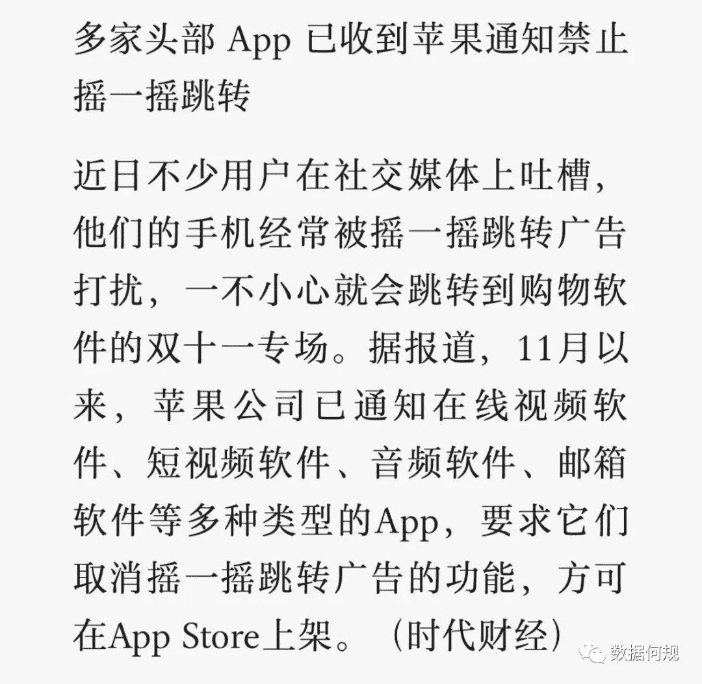
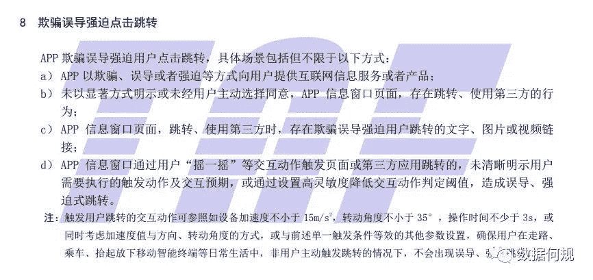
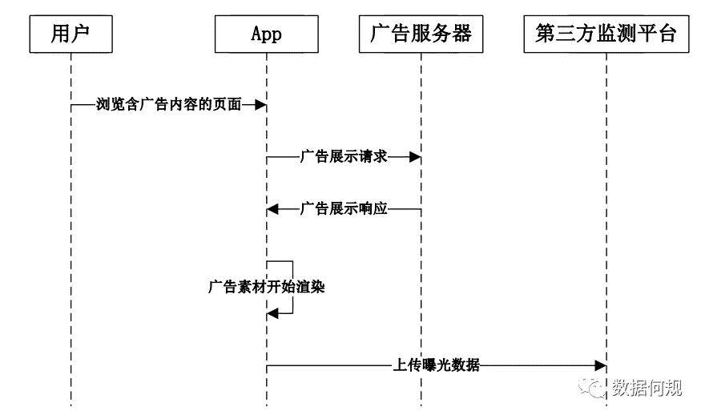

# 苹果禁止摇一摇跳转

> 来源：[https://docs.feishu.cn/docx/YbLRdCUG5oxgwSx3JKWc8nn4nce](https://docs.feishu.cn/docx/YbLRdCUG5oxgwSx3JKWc8nn4nce)

**-问：**大家怎么看？

**-答1：**工信部26条**早就有说这个**，感觉整改效果相当一般（来自一个经常被导流的客户端）。

> 4.窗口关闭用户可选。开屏和弹窗信息窗口提供清晰有效的关闭按钮，保证用户可以便捷关闭；不得频繁弹窗干扰用户正常使用，或利用“全屏热力图”、高灵敏度“摇一摇”等易造成误触发的方式诱导用户操作。

> 👸号：中国政府网

> 26条措施！工信部印发进一步提升移动互联网应用服务能力的通知

**-答2：**去年双十一说了要狠狠打击，今年双十一变本加厉。

**-答3：**摇一摇在过去一段时间里是默许的存在，大厂一直在跟工信讨价还价。甚至带头整改其它部分。

**-答4：**是的，第一年本来就要被干掉的，大厂不同意。

**-答5：**记得去年有一个**团标**还规定了摇一摇的敏感度，从今年双十一现实看起来团标效力确实有限（或者说还有很多可以在边缘反复试探的技术手段。

**-答6：**弱弱问一句，摇一摇的广告界面难道不是被导流的App自己设置的摇一摇吗。最后落地还是广告运营公司在对应投放平台上选择最终的展示内容及方式吧？ 投放平台没有管控权吗？

**-答7：**严格来说，不完全是，也有一些代投的。有很多种投放的方案，比如你投图文、投视频，然后结算方式各有所不同，一些是需要CPC/CPA/CPT结算之类的，就会衍生出来很多很离谱的唤起方式。毕竟跳转了才有钱。摇一摇确实效果不错，还有那种倾斜的，专治躺着玩手机。

投放的形式有很多，如果是公司直接投，确实有一些是可以选择你投放的形式的。

但是代投的话，如果没有约定，代投公司一般会按照结算条款来考虑投放的形式，顶多约定一下（有一些可以排除掉特定的投放形式之类的，或者保证投放合法合规之类的），那代投就是会选择更高效的（对于代投公司来说比如更高的触发、跳转的可能的情况）投放的形式。

广告平台**能挣钱就行**，而且有些是直接上整个联盟的，才不管这么多，有人投，有消耗，有钱挣就行。

投放平台也没有收到消息说违法呀，而且上面大佬也说了，大厂在拉扯（毕竟是挣钱的生意，谁不想广告效果好，多投投呢）。

**-答8：**因为有钱赚，广告主出价高，或者广告平台要完成业绩好拿年终奖，无利不起早。

**-答9：**可能我表达的不清楚。就摇一摇为例，投放平台如果启用了摇一摇，投放其他家的广告，是投放平台自己来控制整个摇一摇的设计和流程 ，调整跳转灵敏度？还是接什么外部Sdk了。

**-答10：**广告联盟有sdk给你接的，接了就可以恰饭了。

**-答11：**看看这张图。

**

总结：摇一摇跳转可耻但能赚钱**。

[APP](https://cbe8t1r4a5.feishu.cn/wiki/wikcnm7SSi199OdP5q0UAot3Fsf)