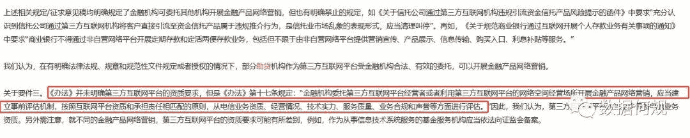

# 助贷APP金融资质

> 来源：[https://docs.feishu.cn/docx/PMrUdJVRboiXDCxRSI9cWI7tnlg](https://docs.feishu.cn/docx/PMrUdJVRboiXDCxRSI9cWI7tnlg)

**-问：**请教下各位大佬，工信部要求的APP备案，应用市场有对助贷类APP提出什么金融资质要求么？

**-答1：**网络接入商是对营业执照里面经营范围关键字看的。在他的关键字名单内的，就要对应牌照。我倒是没细问他们这个关键字清单是不是工信部给的。我们去年就把app软著和知识产权迁移了。迁到有金融许可证的主体公司下了。否则这次app备案也碰到你一样麻烦。

**-答2：**说到这个，想起个神奇的投诉，有个无聊的人投诉到市监局说，网站上发布虚假信息，因为网站备案主体跟宣传内容的主体不是同一个 ，关键市监还真查了。

**-答3：****工**信部不会也无权介入金融监管要求，实践中科技公司和金融机构都可以；但是开展金融业务必须要有金融牌照等文件，发布主体运营主体起码得占一样。

**-答4：**但是助贷类机构到底需要什么金融牌照/资质，目前并不明确。市场上很多APP都在做助贷，比如某打车软件，他们也没有金融资质？我们战略研究过，他们关联方都没有。

**-答5：**助贷不是金融业务，这个蛮搞的，应用市场会看合作协议，我们当时给苹果发过合作协议解释。

**-答6：**看**应用市场了，例如我之前经手的切换主体，App Store不能变还是小贷公司，安卓们都变更为科技公司**了。使用科技公司，填坑时风险会小一点。使用金融牌照，那平时的合规成本就会高很多，填坑时候伺候的爸爸也会多。大厂头部不一定有借鉴价值，因为都是经历了变化的，旧人旧办法。现在新人新办法，一个平台有可能只是做从事引流的广告业务。只不过是给金融机构或者其他助贷平台引流。现在市场上有金融牌照和“纯”科技公司的都存在。理想状态，科技公司控股/持股持牌机构。科技公司是App发布主体，运营主体。

**-答7：**是的，苹果，华为严格，其它稍微好一点。

总结：存量案例，不一定有借鉴意义。

[APP](https://cbe8t1r4a5.feishu.cn/wiki/wikcnm7SSi199OdP5q0UAot3Fsf)

[牌照/资质](https://cbe8t1r4a5.feishu.cn/wiki/wikcnU29fliEy3Bopg6TKTFPLec)

[金融](https://cbe8t1r4a5.feishu.cn/wiki/wikcnHIfJ52k5IkLpp0iNuSUU1c)