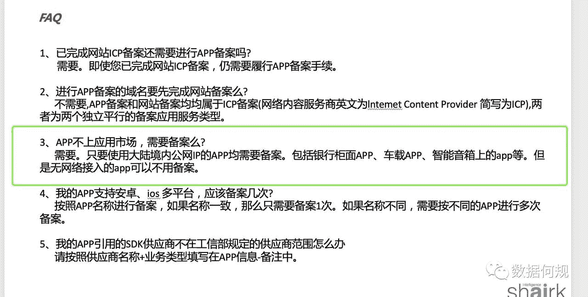

# 非手机端应用ICP备案

> 来源：[https://docs.feishu.cn/docx/Fx1UdMjKEoNqDkxHR4pcNwvenIc](https://docs.feishu.cn/docx/Fx1UdMjKEoNqDkxHR4pcNwvenIc)

**-问：**公司这边有一些大型的B端产品是有交互界面的，其软件要不要做APP备案的呀？或则说，汽车上的交互终端要不要做备案呀？我看阿里云的逻辑好像是，如果他们检测不到备案，就会阻断解析域名，那这种情况下是不是出了手机上的APP，像汽车或别的产品也是要备案的呀？

**-答1：**找你的时候再备也不迟。

**-答2：**车机的app已经开始备案了，非自研的可以让第三方去备案。

**-答3：**还有电视机端的。

**-答4：**比如一些智能手表，里面内置的一些功能，比如苹果手表里的时钟，这种算是要备案的APP吗？记得之前有次凑巧听了一下智能手表的标准，有个争议点就是关于基础功能内置的APP。

**-答5：**之前通管的意思是**只要能联网就让备案**，不管是不是内置的。

**-答6：**是的，我这边接收到的情况也是这样。

**-答7：**要的。

**-答8：**刚刚打电话问了阿里云，那边说：一级域名做了备案，APP接的二级域名，APP没做备案，是不会阻断联网的。车机或则别的终端练的下级域名也是类似的道理，只要一级域名做了备案，不会出现被阻断。因为这个阻断解析域名是整个一级域名一块阻断。但是APP，小程序不做备案，自然过不了应用商店的审核。其他不上应用商店的，是还可以联网的，但是还是建议我去备案。因为根据工信部的要求，就是联网了就要备案，说这样更保险。

**-答9：**之前打北上广ICP备的电话咨询，得到反馈是说中国境内联网的App小程序都直接做App备案，不用再做ICP备。可以再核实一下。

**总结：统统备案。**

[APP](https://cbe8t1r4a5.feishu.cn/wiki/wikcnm7SSi199OdP5q0UAot3Fsf)