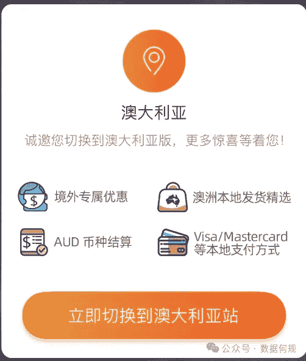

# 一个APK同时境内外上架

> 来源：[https://docs.feishu.cn/docx/E32YdOpegopv7vxwGLGcNigynJx](https://docs.feishu.cn/docx/E32YdOpegopv7vxwGLGcNigynJx)

**-问：**产品部门为了减轻维护人力，想只做一款APP，然后上架国内应用商店和海外应用商店。APP会通过用户的DNS判断用户是国内用户还是海外用户，然后来区分使用国内和国外的服务器存储海内外用户的数据，区分使用不同的海内外域名。我感觉合规上没问题，但是会不会存在应用商店上架过程的一些别的阻碍之类的？我好像目前也没见过哪个APP会通过这种方式来同时上架海内外的应用商店。

**-答1：**那你就让他们去上架呗，能上去就行。

**-答2：**淘宝就是这么搞得。

**-答3：**建议区分开  app 通过 DNS 来判断用户是境内还是境外会出现误判 误判情况下导致本属于国内的用户存储到海外服务器（哪怕只是传输） 如果被网信办监测到 会被监管约谈。

**-答4：**注册怎么注册？需要手机号么？让用户选一下呗 海外版的话 需要本地手机号注册？

**总结：稳妥点还是算了。**

[APP](https://cbe8t1r4a5.feishu.cn/wiki/wikcnm7SSi199OdP5q0UAot3Fsf)