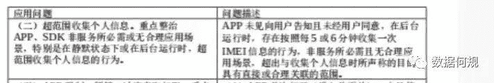

# SDK审核标准

> 来源：[https://docs.feishu.cn/docx/KxosdbHoEoMEGCxHQvwcOZCqnKh](https://docs.feishu.cn/docx/KxosdbHoEoMEGCxHQvwcOZCqnKh)

**-问**：最近应用宝的检测标准是不是变严格了，我们的一款APP因为三方SDK没过审，理由之一是SDK收集频率过高，给出的标准是全局不得超过三次，每分钟不得超过1次。有大佬知道这个标准是哪里来的吗？

**-答1：**有通报案例。

**-答2：**谢谢，我们现在在和三方SDK谈的有点艰难，我拿着案例去争取争取。

**-答3**：SDK几种，1，付费合作的，最好谈，而且人家也要生存的，改的动作很快；2，大厂的，比如腾讯，百度这种开放的sdk，头皮很倔。监管通报了，才老实点；3，就是开源sdk，特别烦。看作者心情的，有时候我们自己改代码编译新包解决隐私保护问题的；4，集团或者其他bu的sdk，更烦，不能撕破脸，但是问题又贼多。只能一家家找了，熬时间慢慢修复。

**-答4：**还有我们这种集团统一部署SDK的，明明知道有问题检测出来也有问题，跟集团沟通不上。

[SDK合规](https://cbe8t1r4a5.feishu.cn/wiki/wikcnBRo8jxV2MQwoTa63T6qfce)