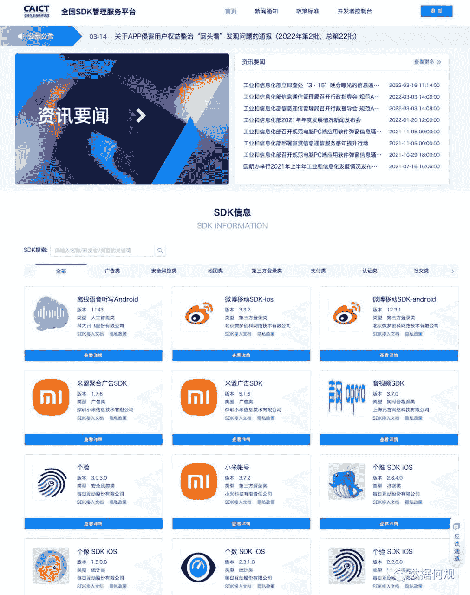
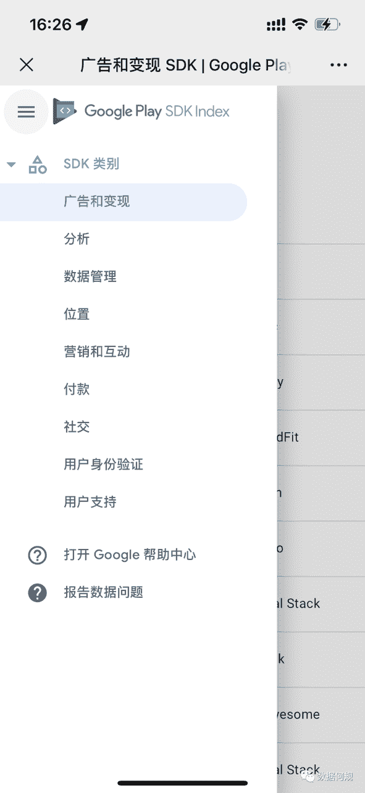
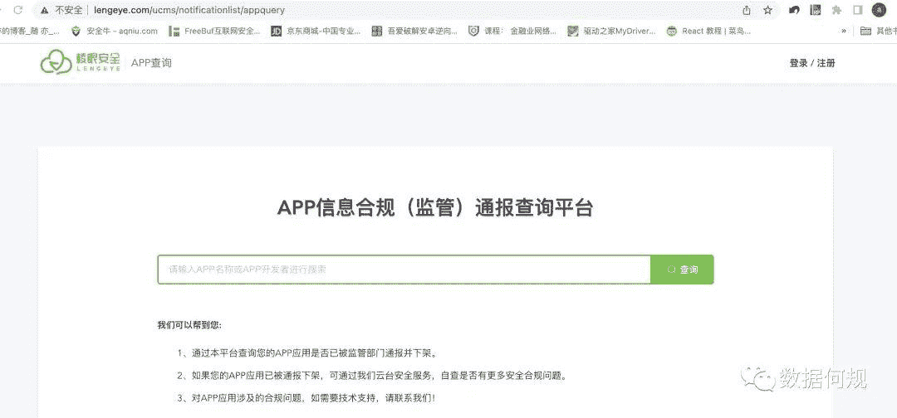

# SDK信息查询

> 来源：[https://docs.feishu.cn/docx/A3pIdv0eRoHx3YxEQNpcCXb9n9d](https://docs.feishu.cn/docx/A3pIdv0eRoHx3YxEQNpcCXb9n9d)

**-问：**有什么好的SDK信息查询渠道吗？

**-答1：**https://sdk.caict.ac**.cn/official/#**/home 信通院全国SDK管理服务平台提供公开查询了，可查到各家上报SDK的情况。

**-答2：**https://play.google.com/**sdks/categories**/ads，Play Store也有个索引。

**-答3：**这个网站**棱眼**也很好，分享一下。http://lengeye.com/ucms/notificationlist/appquery

[SDK合规](https://cbe8t1r4a5.feishu.cn/wiki/wikcnBRo8jxV2MQwoTa63T6qfce)