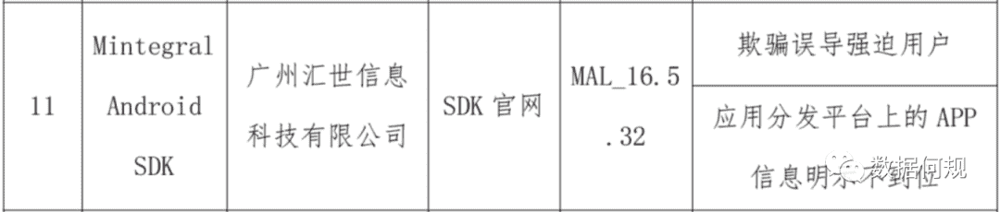
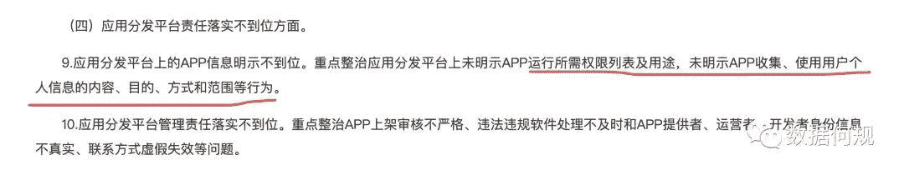
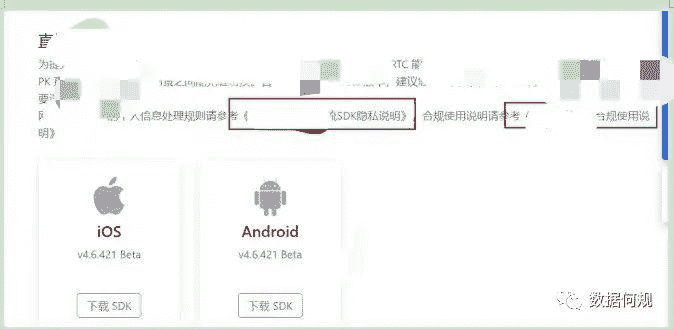

# 广告SDK被通报应用分发

> 来源：[https://docs.feishu.cn/docx/MuKZdZT0BoxBadxsE86cT3CAnog](https://docs.feishu.cn/docx/MuKZdZT0BoxBadxsE86cT3CAnog)

**-问：**请问一下这种sdk被通报应用分发信息明示不到位是具体什么表现啊？

**-答1：****有一个通报点是，a**pp官网下载没有放隐私政策和权限列表。不知道SDK是不是也是同理？

**-答2：**广告SDK提供下载APP类的广告时没有告知用户六要素。对提供下载APP功能的SDK，会有一些分发平台上的要求

**-答3：**应该是披露没满足五要素要求，开发者名称、应用名称、版本号、权限、隐私政策这些。监管应该还比较关注带有应用分发功能的SDK的合规。

**-答4：**现在是六要素，加了“**功能简介**”。

**-答5：****这个问题的“明示不到位”就**是 sdk下载页面没有附上sdk 隐私政策和接入的合规说明。也就是说，现在 sdk 隐私说明要单独列明，并且需要在这个下载页面放置对应链接。

总结：提供APP下载功能的SDK，也需要满足分发平台相关要求。

[SDK合规](https://cbe8t1r4a5.feishu.cn/wiki/wikcnBRo8jxV2MQwoTa63T6qfce)