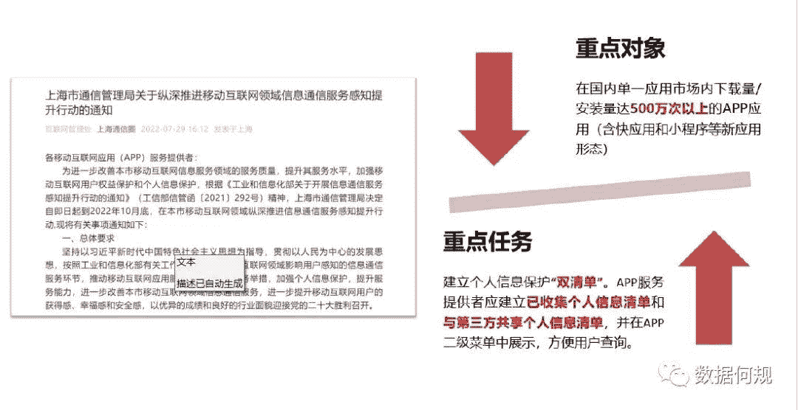
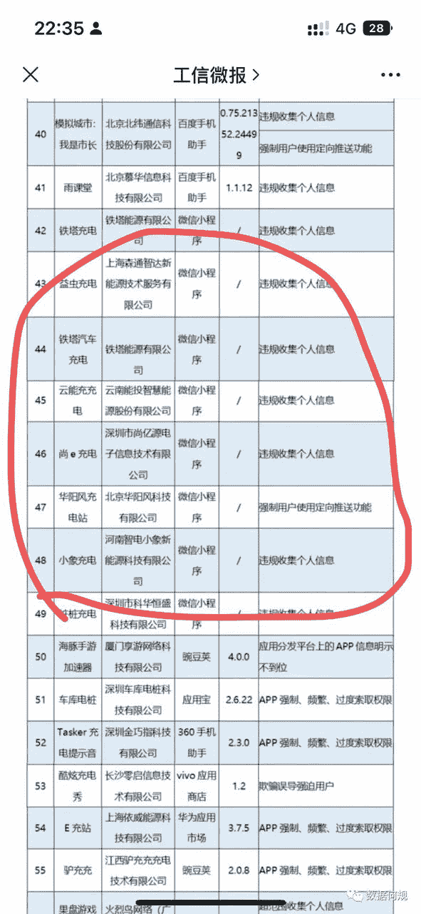

# 小程序双清单要求

> 来源：[https://docs.feishu.cn/docx/XEOtdiimSoANfqxjR4bcUb4Cnxg](https://docs.feishu.cn/docx/XEOtdiimSoANfqxjR4bcUb4Cnxg)

**-问：**请教下各位大佬：双清单只是明文要求app做吧 ，监管有检查要求到小程序维度也要实现双清单吗？

**-答1：**上海通管局的要求里，**小程序也是一样**的。安装量500万是一条线。

**-答2：**浙江是**100万注册量**就要。

**-答3：**工信部通报也**通报**小程序。

**总结：小程序也要管。**

[小程序合规](https://cbe8t1r4a5.feishu.cn/wiki/wikcnp6uxtmPBkhJMrHz0EERWJc)