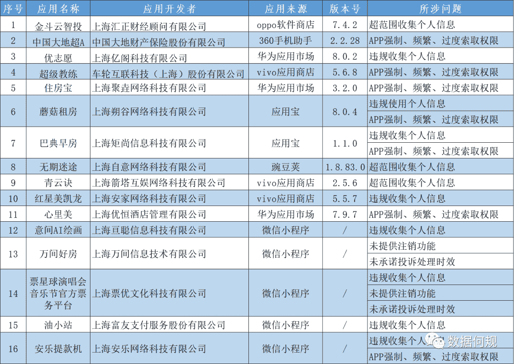
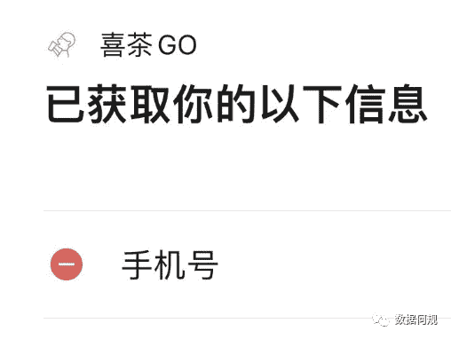

# 小程序注销功能要求

> 来源：[https://docs.feishu.cn/docx/HtJSdaMFUoyY0KxoMy6cNoxJnjd](https://docs.feishu.cn/docx/HtJSdaMFUoyY0KxoMy6cNoxJnjd)

**-问：**原来小程序也要注销功能了，上海市通信管理局关于侵害用户权益行为APP的通报（2023年第一批），有很多小程序做了吗？

**-答1：**很多小程序做了，麦当劳、唯品会、滴滴、京东等。海南省首次通报小程序的时候就有账号注销难的通报项。

**-答2：**微信小程序，本来有删除已收集个人信息的能力。删了手机号，其实就是注销了吧。

**-答3：****没有，小****程序运营**者**那边还有****保存。-**答4：需要用户再次进入小程序时形同新号。-答5：**按理来说**，实名制的要求出来后，删除手机号后账号就应该注销了，如果要继续使用需要重新绑定手**机号，但**其实还是有很多三无账号存在。-答6：如果多入口 注册信息后台共享呢。-答7：需要了解背后账号系统管理，进行数据的删除。一般会有一个统一的udid的识别。解绑+删除。-答8：平台与小程序 是授权绑定关系。删除在后台 这样才是注销。小程序上注册 会有2步 使用openid注册后 是否授权给手机号码。具体描述 可能不准确啊。传手机号码那种，解绑注销没有完全注销。很多公司会有App  微信小程序，支付宝小程序 百度小程序 等多个入口，每个入口都有注册功能。通过小程序注册有使用第三方账号授权登录，这时候后端表里记录的是Openid。在第三方登录后例如微信会提示，是否共享手机号码，这场景下后端的表内就会在手机号码字段中写入手机号。有些 公司的后端设计是 每个入口一张表 几个入口的表再共享。 在这种设计下 单小程序的注销只会删除该入口表中字段。整体账户表中没有删除。表象就变成了在小程序入口中 看到的是需要重新授权。而在App的中可以并没有注销。-答9：那我理解这种不属于账号注销，重新授权后应该会关联到之前的账户，注销前的信息都会复现。

[小程序合规](https://cbe8t1r4a5.feishu.cn/wiki/wikcnp6uxtmPBkhJMrHz0EERWJc)