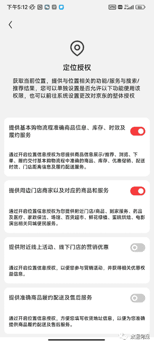

# 获取权限的颗粒度

> 来源：[https://docs.feishu.cn/docx/TkQhd9byPoB7ZexApsQc6PWzn9f](https://docs.feishu.cn/docx/TkQhd9byPoB7ZexApsQc6PWzn9f)

**-问：**京东这个好卷。

**-答1：**区分场景的位置授权？🛰️感觉是最早做的。

**-答2：**这个做得真好，但是后台真的能全部根据场景关掉吗，比较好奇。

**-答3：**可以的，在调用系统权限后，App内再做一层识别和控制。

**-答4：**可以，技术上好实现的。其实我们现在的弹框文案就是专门的授权管理平台配置的。加权限或者加新场景。

**总结：作为用户，希望越卷越好，越透明越好**。作为企业，难免感觉好卷，合规成本好高。

[权限获取](https://cbe8t1r4a5.feishu.cn/wiki/wikcn5sa8AZhNVbp1RH4oe0Msuh)