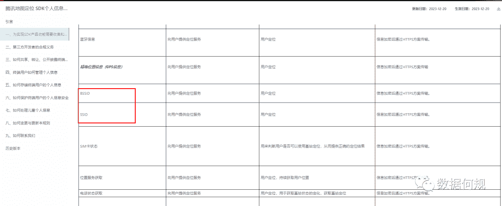

# SSID和定位权限的关系

> 来源：[https://docs.feishu.cn/docx/E9csdAcgZodKO0xTnk8ccZCRnRg](https://docs.feishu.cn/docx/E9csdAcgZodKO0xTnk8ccZCRnRg)

**-问：**请教一下各位大佬：BSSID和SSID的调用频次，和定位权限申请是否相关？（我看着日志挺相关的但不确定）

**-答1：**有关的，**跟位置信息有关**。

[权限获取](https://cbe8t1r4a5.feishu.cn/wiki/wikcn5sa8AZhNVbp1RH4oe0Msuh)

[技术概念科普](https://cbe8t1r4a5.feishu.cn/wiki/GfWtwCXWbiBzgQk1sxUcfFgXnSP)