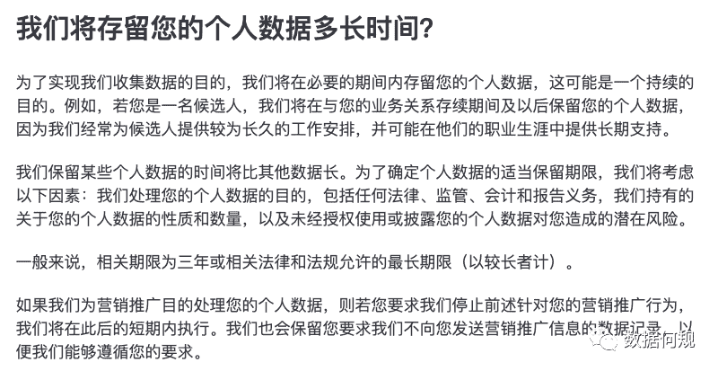

# 应聘者数据留存期限

> 来源：[https://docs.feishu.cn/docx/Udgxdu8gDoF3D6xhyQecWpaGnS5](https://docs.feishu.cn/docx/Udgxdu8gDoF3D6xhyQecWpaGnS5)

**-问：**请教一下大家，实务中，对应聘者个人信息保护期限一般怎么做呀？有无特别的留存期限要求？若无明确期限的话，对于未录取候选人，考虑到诉讼时效那些 ，在招聘个人信息处理规则中，约定3年，并且告知如何行使删除权是不是就差不多了？对于录取的候选人，纳入员工档案管理即可？不知道有没有什么比较好的实践，我随手搜了个猎头公司确实是3年。

**-答1：**我们也写的3年，但是可能还有其他情况。

**-答2：**理解一致。去年在处理金融机构数据出境时候，把单独同意和存储期限一并处理了，通过招聘信息、邮件的方式，在触达候选人的时刻解决了告知同意的问题。录取候选人纳入正式员工，就适用员工手册。

**-答3：****18m-5y**的都看到过。

**-答4：**同为3年，神奇，应该基操。

**-答5：****ISO**体系中审核机构也是建议3年，对于未被聘用的。

**-答6：****劳动合同是2年**，但是考虑诉讼等因素，实际会超3年，遇到有其他的保密义务或竞业限制义务，时间可能会更长。未聘用者也可以参考适用。

**-答7：****多提供一个视角，**也**可以参考域外的，比**如**欧盟是最多6个月，中国香港地区是2年。以欧盟为例，对于对于未被录用的人，企业在招聘过程中做出了录用决定之后，就不得再处理没有录用的应聘者的信息，最多可以**保留六个月预防可能的争议，即使要继续保存未录用的应聘者的信息形成所谓的人才库，也必须获得其同意且保留期限也不能延长。如果跟域外一体化使用人力系统的公司，是可以参考选取对本企业管理成本较小的一种方式。

**-答8：**说下我的看法：这个期限应该是跟公司的talent project相关的。HR要先有关于人才库的规划，考虑需要留存的最佳期限，然后才是合规性考虑和实施路径。另外，如果是国企，需要符合档案法中关于文件存档的相关期限规定。

**-答9：**若无人才库，是不是应该没要就删了。如果有人才库，可以明确问他，愿不愿进库，进库X年？

**-答10：**没有人才库计划，纯粹按法定的话，可以参照劳动监管部门的规定（名字我忘了），除工资记录之外的档案最短需要保管两年。因为没有正式录用，所以是参照。可以在面试填表时增加关于存储期限的同意内容，以补充合法性基础。

**-答11：**我们国企客户，这个资料确实说按照档案管理来的。我没问具体期限。

**-答11：**印象中是**五年**。档案法对于国企和政府单位来说，是必须执行。其他类型可以参照执行。不同类型的文件资料期限不同。

**-答12：**要看看你们单位hr 有没有维护这本candidate的信息库。

**总结：存3年，做好告知同意，保障删**除权，没问题。欧盟企业抄母公司作业就好。

[招聘](https://cbe8t1r4a5.feishu.cn/wiki/wikcnrutNhoLSm5s9ESK30T6gDv)

[存储期限](https://cbe8t1r4a5.feishu.cn/wiki/B5NAwKuzNiGYu8kYKBXcz0dqn2e)