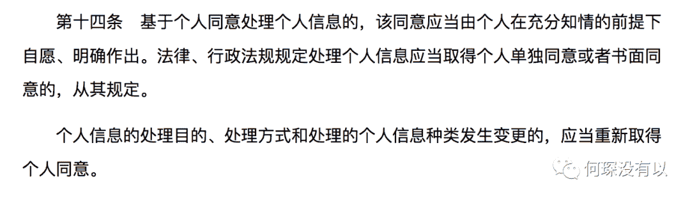

# 刷脸考勤的合规性

> 来源：[https://docs.feishu.cn/docx/A2K1dUilxohTtBxP3rscOJcpn3g](https://docs.feishu.cn/docx/A2K1dUilxohTtBxP3rscOJcpn3g)

**-问：**公司刷脸考勤的场景下，员工接受刷脸打卡的行为算不算对公司处理人脸信息的默认同意？

-答1：国内没有**默认同意**这一说**法。从合理性角**度，是否构成同意，个人认为需要结合员工刷脸后的动作确定，如果员工前几次打卡后提出异议，个人认为是不构成同意的。真的同意的没那么多事，不用补也没问题。有异议的不补还好，一补就拒绝签字，明示拒绝。这个跟劳动法领域让员工签字确定新制度的实践有异曲同工之妙。有物业公司采用opt-out机制，拒绝的边上登记申领门卡。

**-答2：**前提是员工一直没有异议。我在想还是补书面同意比较保险 因为首次采集的照片要长期存储 而动作默认更多是针对采集行为。应当告知的有“个人信息的处理目的、处理方式、处理的个人信息种类、保存期限”，这里面种类（可能是视频、照片）和保存期限是无法被员工直接感知的。

**-答3：**补采集同意。关键点，离职有没有删。

**-答4:**

根据《个保法》第14条的“**充分知情**”要求，同意是没法默示的。同时告知也没有做。不合规。

[人力资源管理](https://cbe8t1r4a5.feishu.cn/wiki/wikcnAQjK9Z5BhpyZrwxfZd1FCc)

[生物识别信息](https://cbe8t1r4a5.feishu.cn/wiki/XGNSwPRG2iCpPdkB4X0cX0w6n1e)