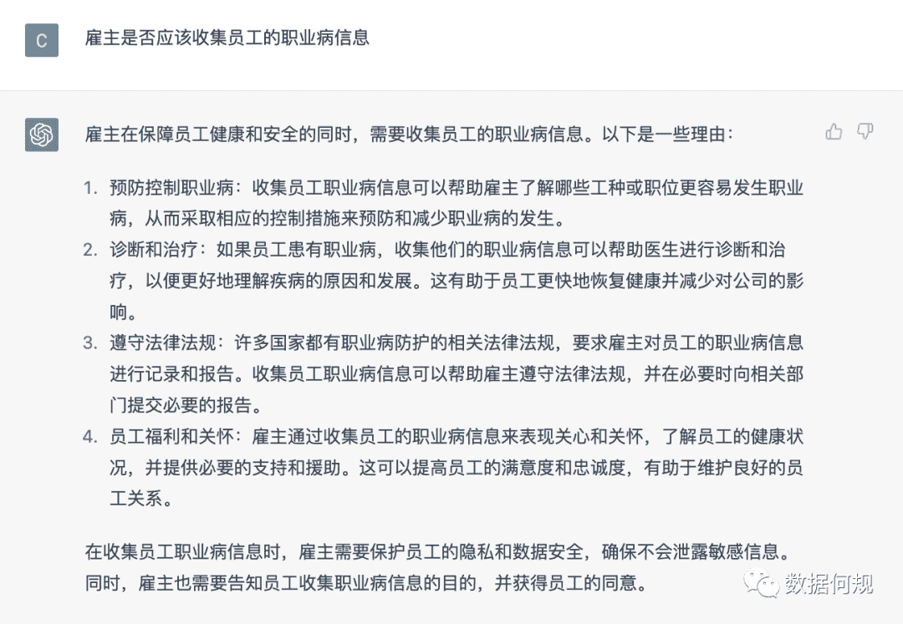
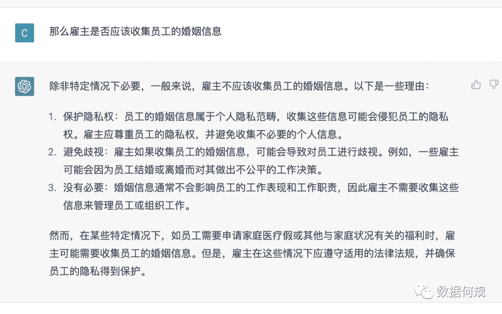

# 收集员工信息的必要性

> 来源：[https://docs.feishu.cn/docx/EOHUdusCyopkNux1k6mcGzY1nog](https://docs.feishu.cn/docx/EOHUdusCyopkNux1k6mcGzY1nog)

**-问：**收集员工婚姻、职业病等信息需要单独同意吗？

**-答1：**我觉得要，因为超出企业允许收集的员工信息了，属于非最小必要信息。而且医疗健康信息本就属于个人敏感信息。我其实一直觉得公司免费给员工体检，就是为了获取授权能够看员工健康信息。

**-答2：**职业病防治条例(好像叫这个）里面好像有规定企业要建立健康档案什么的，不过应该是针对职业病的。

**-答3：**我觉得可能要看行业，比如药品管理法里面好像也有要求接触药品的工作人员需要每年进行健康检查

**-答4：**我觉的如果选择同意作为合法性基础，属于敏感个人信息就单独同意。如果存在其他关联性更强的就选择更适合的合法性基础。

**-答5：**特定岗位特定职位的职业病信息，还是可以理解为履行劳动合同所必须吧。

**-答6：**首先是最小必要的问题，第二才是单独同意的问题。

**-答7：**Chat GPT的回答。

**总**结：处理敏感个人信息前，先做PIA，评估完合法、正当、必要性，再讨论处理个人信息的合法性基础吧。拥有雇佣关系中的强势地位也不能胡来呀。

[人力资源管理](https://cbe8t1r4a5.feishu.cn/wiki/wikcnAQjK9Z5BhpyZrwxfZd1FCc)

[单独同意](https://cbe8t1r4a5.feishu.cn/wiki/wikcnJE9n6JylcRx7c3La4Yjahd)