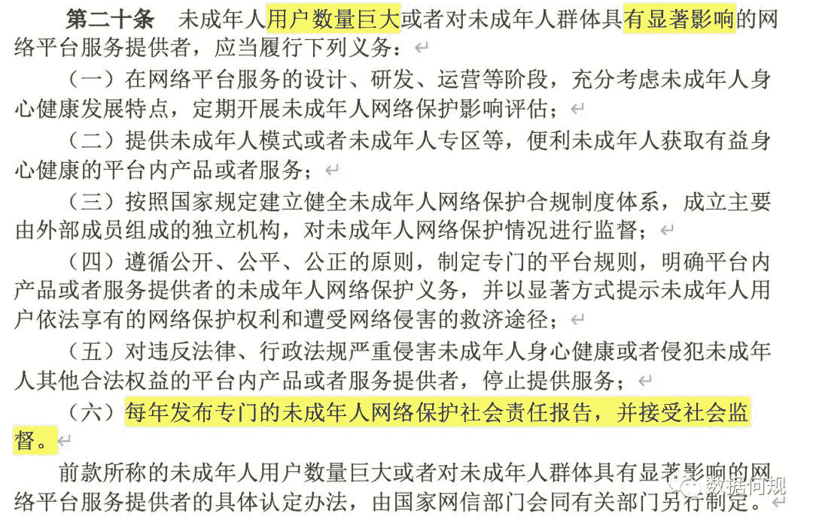

# 《未成年人网络保护条例》讨论

> 来源：[https://docs.feishu.cn/docx/I9oVdOkW7o26c7xtKhYc7K0lnPd](https://docs.feishu.cn/docx/I9oVdOkW7o26c7xtKhYc7K0lnPd)

**-问：**[《未成年人网络保护条例》](https://mp.weixin.qq.com/s?__biz=MzA4MDA0MzcwMA==&mid=2652657150&idx=1&sn=7d6341cabf8875b454d99359258a8626&scene=21#wechat_redirect)发布了，大家怎么看？

**-答1：**第三十七条：个人信息处理者应当自行或者委托专业机构每年对其处理未成年人个人信息遵守法律、行政法规的情况进行合规审计，并将审计情况及时报告网信等部门。这条要求好高，年度审计竟然没有门槛。处理未成年人个人信息，是处理了一条未成年人信息就算吗？但这一条没有罚则。

**-答2：**太可怕了，企业困难好大。

**-答3：**毕竟是未成年人的，祖国的花骨朵，一切从严。

**-答4：**这个刚刚有分支被网信办检检查，网信办说最好找检测单位，我问当前能做这个检测的不多啊。

**-答5：****被监管认定未成**年人用户数量巨大或者对未成年人群体具有显著影响，还要每年发年报。感觉这个还沾点ESG。b站要是被认定了，未成年退款估计能算年报的重要内容。

**-答6：**这……只要企业收员工未成年人子女的信息也要报CAC咯。

**-答7：**交叉看看合规审计那个里怎么说？

**-答8：**个保合规审计那个规则没出来，感觉对大企业而言，就个保审计的时候捎带手做了。然后对非以未成年人为主要客户的行业，写个保制度的时候捎带手也写一章。

**-答9：**未成年人是一个可大可小的话题，未成年人里还有细分婴儿、儿童和大龄儿童，每一个组别都有不同的要求，这里不止是数据合规领域。3、7、8、10、12、14、16，都不一样。本着不说黑话的原则，稍微展开一下，帮群友了解串一下：3岁以下是婴儿产品的国标线，盲盒销售须超过8岁，儿童广告代言人是不超10岁，儿童化妆品是12岁以下，儿童网络信息保护是14岁以下。所以当业务说“儿童”，要看在什么场景里用，不同部门法的“儿童”年龄线都不一样，脑袋要转得过来。7岁是学龄前儿童。

**总结：难，合规好贵。**

**相关阅读推荐：**

**1、****司**法部、国家网信办有关负责人就《未成年人网络保护条例》答记者问；

**2、**[**事关未成年人网络保护，权威回应**](https://mp.weixin.qq.com/s?__biz=MzAwMjU0MjIyNw==&mid=2651460742&idx=1&sn=1e5c262fb329c3210e4910e304cd498c&scene=21#wechat_redirect)**；**

**3、****关**于《未成年人网络保护条例》的28点碎碎念；

**4、****《**未成年人网络保护条例》合规义务全景解读。