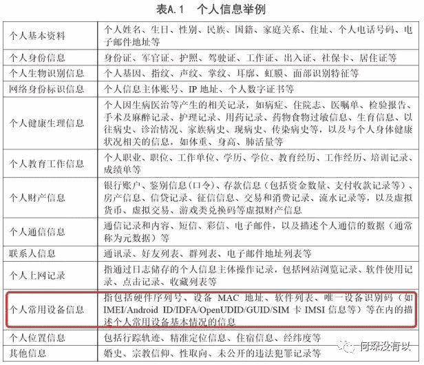

# 广告主处理个人信息的合法基础

> 来源：[https://docs.feishu.cn/docx/KzbIdubLWoNaxHx3ZgkcWhuinAc](https://docs.feishu.cn/docx/KzbIdubLWoNaxHx3ZgkcWhuinAc)

-**问：**媒体平台向广告主提供用户设备信息（包括可变和不可变的标识，且这些用户有的是广告主自身的原有客户，有的不是），再由广告主从中挑选向哪些设备发送广告。在这个过程中，对于不是广告主自身原有客户的设备信息，在其被广告主最终结合其他信息识别为特定个人前，是否达到《个保法》下“已识别或可识别的自然人有关的各种信息”的标准？是否应被认为个人信息且应履行个保法规定的义务？如是，广告主在聘请第三方进行投放分析时，如何取得处理的合法性基础？

**-答1：****相关设备ID可以协助识别出个**人，走可识别的路径应该是个人信**息。可是广告主**连触达渠道都没有，告知同意没法做。

**-答2：**“可识别”应该还是限于某一个法律主体可识别吧，对这个主体来说只要识别不出来，就不应该课以个保法项下的义务；反过来说对某个主体不可识别的信息，结合其他主体掌握的信息，一定是能识别的，这种上帝视角的“可识别”，就没有区分的意义了。但是第三方分析公司有可能识别出来，它可能还有其他数据，数据融合后可能就重标识了。

**-答3：**《个人信息安全规范》附录已经广告ID是个人信息了。

**-追问：**如果确实属于个人信息，如何取得合法性基础？

**-答5：**间接收集，让**媒体拿用户的授权同意**？现在做个业务好难啊。有些平台的隐私政策里提到广告优化的时候，是说对外提供的时候，用去标识化、匿名化或加密等措施处理后，使接收方无法直接识别到用户身份。但我也不太确定，这样是不是就能达到个保法的要求了。

**-答6：**分享两**点：1. **这种碰撞通常只有advertiseid，就是idfa,oaid,gaid这些。广告投放过程，除了自有私域中，通常不应该有不可变id。另外一般这种场景的ad-id可以支持hash后碰撞。2. 可能在于谈判地位了，通常常见的广告投放方会有这种人群包服务，广告主带着id的人群包去投放。

**-答7：**其实当前隐私政策最终目的就是，让用户知道并确认广告投放行为。

**-答8：**媒体方的广告主那么多，如果按个保法的要求，媒体方把用户信息给到第三方广告主，得披露广告主的信息，那得是多长的一个清单啊。可能只能作为附件了。

**-追问：**人群包可以展开说说吗？

**-答9：**人群包通常有**custom audience**和**lookalike**不同模式，基本逻辑都是广告主带着自己的advertising id包来投放，格式自选，可以支持特定哈希算法后的id。投放方根据这些id匹配，投放给命中的人群，或是和这些人群相似的人群。

**-答10：**分享几篇人群包的推送：（1）当没有人[群画像时，腾讯广告](https://mp.weixin.qq.com/s?__biz=MzU3MDI4NDkyNg==&mid=2247483941&idx=1&sn=3c6010945cc7a24115af3c7427bdf2df&scene=21#wechat_redirect)人群包可以这么玩；（2）腾讯广告人群包玩法；（3）个性化广告与个人信息保护如何平衡的几点思考。

[合法性基础](https://cbe8t1r4a5.feishu.cn/wiki/wikcnMO3dv4wwxpr7KunwIHHfwd)

[广告营销](https://cbe8t1r4a5.feishu.cn/wiki/wikcnofMjiKrU1uUV11dzaNQfJd)

[对外提供](https://cbe8t1r4a5.feishu.cn/wiki/wikcnKiT2Zx8SW3B6K4rfGKmXee)

[单独同意](https://cbe8t1r4a5.feishu.cn/wiki/wikcnJE9n6JylcRx7c3La4Yjahd)