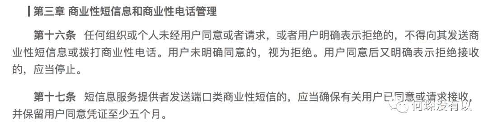

# 营销短信的同意

> 来源：[https://docs.feishu.cn/docx/A6KFdeHkgo1hmFxNt5kcckzLn5c](https://docs.feishu.cn/docx/A6KFdeHkgo1hmFxNt5kcckzLn5c)

**-问：**发送营销信息，是不是在隐私政策里general地取得授权并不够（因为是非必要？）是不是要单独同意？

**-答1：****有的做了**，之前一个案子上，监管说至少要隐私政策写，具体可能还是看执法尺度吧。

**-答2：**个人理解，营销短信没有类似于合同履行必要这类的合法基础，所以一般只能依靠于**个人**同意。然后，《通信短信息服务管理规定（征求意见稿）》里面应该是有对商业短信有明确的要求。

我感觉这个义务依靠**单独同意**才能比较好实现。但该规定尚未正式生效。

[广告营销](https://cbe8t1r4a5.feishu.cn/wiki/wikcnofMjiKrU1uUV11dzaNQfJd)