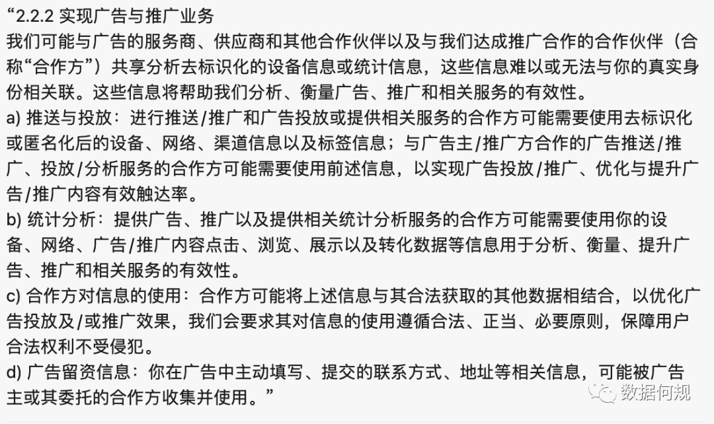
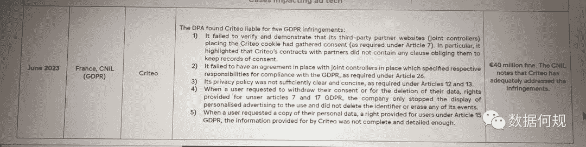

# 广告投放告知同意

> 来源：[https://docs.feishu.cn/docx/HoM3dIJqSoYN2NxPEsscpcsXnNg](https://docs.feishu.cn/docx/HoM3dIJqSoYN2NxPEsscpcsXnNg)

**-问：**请教下，这种场景下的共享是不是也构成个人信息的共享而需要单独同意？所谓站外投放  阿里和抖音打造的unidesk好像类似这种模式功能。

**-答1：****放在第三**方共享清单里，及时更新广告主名单等。-**答2：程序化广告，共享的范围很**广。共享一个设备号，跟外部[的数据结合，再做精准化投放](https://mp.weixin.qq.com/s?__biz=MzIzMjEyODA2Nw==&mid=2649145083&idx=8&sn=51de6bc7edaa4065e61a27fd0524538f&scene=21#wechat_redirect)，很难说不是个人信息的共享和处理。欧盟也有相关案件在审理，朱悦：数据保护的都柏林效**应。Ryan的工作相对没有那么知名，但或许更为“致命”。简言之，其在五个法域发起彼此补充的程序，力求各地数据当局和法****院宣判整**个程序**化广告生**态的违法性。核心诉求有三。一是将其中由技术“裹藏”的许多数据认定为个人数据，以及将用于分组或画像的许多数据认定为敏感个人数据。二是将经营生态的IAB以及生态中的交易所、买卖方平台和网站与应用等认定为共同控制者。三是认定相应处理违法。如果一和二成功，三是水到渠成。这些控制者目前几乎没有遵从保护义务。

-答3：正好也想补充，前几天cnil刚好出了Criteo案，有些内容说不定也相关。另外tcf 2.2版的更新也在尝试处理一些合规问题。但很难具体能解决多大问题。还是得看几个平行程序的发展。Criteo案：个人数据保护继续穿透数字广告生态。-答4：不是“说不定”，是确定相关。Criteo案也是将Criteo平台认定为joint controller，在consent要求和joint controller认定上，逻辑跟IAB案很像。

**-答5：**而且要点展开以后切实的细节不少，ePD和gdpr，同意和合法利益，还有指纹的访问权，有些之前应该会是疑难。

[合法性基础](https://cbe8t1r4a5.feishu.cn/wiki/wikcnMO3dv4wwxpr7KunwIHHfwd)

[广告营销](https://cbe8t1r4a5.feishu.cn/wiki/wikcnofMjiKrU1uUV11dzaNQfJd)

[对外提供](https://cbe8t1r4a5.feishu.cn/wiki/wikcnKiT2Zx8SW3B6K4rfGKmXee)

[单独同意](https://cbe8t1r4a5.feishu.cn/wiki/wikcnJE9n6JylcRx7c3La4Yjahd)