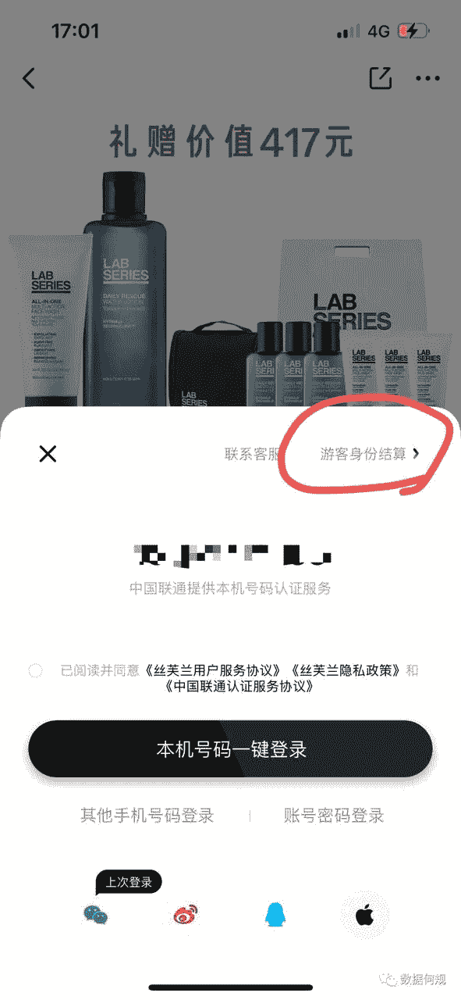
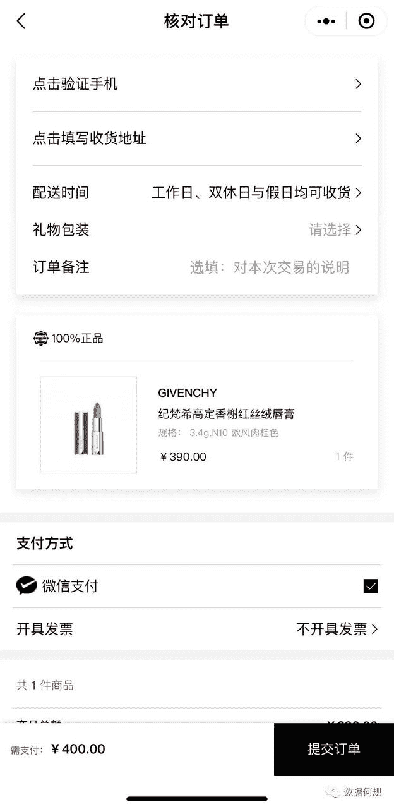

# 购物游客模式

> 来源：[https://docs.feishu.cn/docx/AejKdNrgsoRMzNx1fFOcw8KlnYb](https://docs.feishu.cn/docx/AejKdNrgsoRMzNx1fFOcw8KlnYb)

**-问：**现在有要求说购物网站必须注册才能购买吗，换句话说，不可以有游客模式（应该没有吧）

**-答1：**大平台app都没有做游客模式，游客模式不是技术实现难度问题，是不符合行业发展利益（看看就走，不留下你的痕迹，我怎么抓取你的行为数据呢），当然监管爸爸说必须要有就得有（求生欲）。

**-答2：**我最喜欢游客模式了，我不想注册任何东西，就只想fast purchase，这种游客模式一般来说都是手机验证一下完成实名制要求——以上应该没有不合规吧。那不管这个名字叫啥，流程是最后购买前去验证手机号（而不是一开始注册一个所谓member），其实是为了完成实名制要求，这样有什么问题么。

**-答3：**好奇，不注册的话，后续怎么查订单信息？

**-答4：**手机号可以查询订单。

**-答5：**提供了手机号和地址，和注册也差不多吧。

**-答6：**为了完成购买，肯定会有快递地址的（而且这个地址很可能是收件人而不是下单人本人，所以我觉得和会员模式还是不一样的），至于查询的话好像不会用地址去查订单，订单号和手机号一般都能做到查询功能的。

**-答7：**印象里《电商法》和《网络交易监督管理办法》没有针对购买者有实名认证的要求。但是现在电商平台集成的功能比较复杂，比如App为用户提供信息发布、即时通讯等功能，根据《移动互联网应用程序信息服务管理规定》等规定，应当要求用户完成身份信息认证。根据一般购物的流程，这种进行即时通讯的功能是随时可能发生的，比如发生在下单之前和卖家沟通。

**-答8：**快递物流，有实名制要求。

**-答9：**手机号，也算实名认证吧？只是这个手机号是收件人的，不一定是下单这个人的

**-答10：**对的 可能涉及到不同实名认证的要求。然后关于实名认证和个人信息最小必要原则的平衡。

**-答11：**我觉得这个流程里需要进行实名制认证是一个需要完成的动作，且手机号应该也算是实名认证的一种形式。

**-答12：**换个角度想 手机号码 收都收了  给你算成注册用户吧。浏览商品是一个场景，该场景 不需要用户个人信息 ， 游客模式 应该是基于这点做的。

**-答13：**那我的问题来了，手机号验证这个环节需要发生在购买前吗，还是直接结账前完成就可以？如果是购买前，购买前=下单前 or 付钱前？

**-答14：**可以看下丝芙兰的实践。我记得之前farfetch也有的，刚看了没了…马上去体验了一下，进入下单环节还是要验手机号码的。

**-答15：**可以可以，游客身份结算就给了消费者一个不愿意接收其他信息的机会。这种游客身份结算购物体验应该是接近于卖场柜台体验了。我就想只是给你个购买相关的信息，我就不想当会员注册好么。

**-答16：**这样是最合理的 个人信息只进入order库，不进入crm。

**-答17：**下单验证手机号应该是满足实名制要求了。快递实名制要求。只是实名后的信息会不会自动转成会员呢？如果自动转就不合规了。

总结：只提供手机号，不注册会员，才是最小必要性的最佳实践。

[账户实名制](https://cbe8t1r4a5.feishu.cn/wiki/wikcnlF1aWukA2FQWqqvt69CjGe)

[APP](https://cbe8t1r4a5.feishu.cn/wiki/wikcnm7SSi199OdP5q0UAot3Fsf)