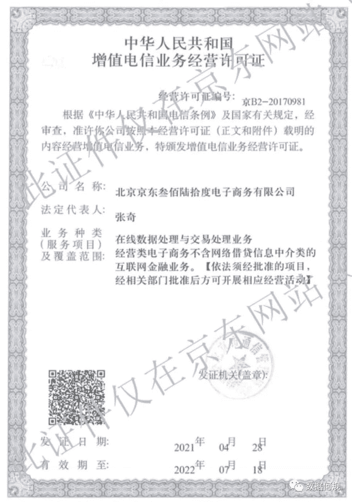
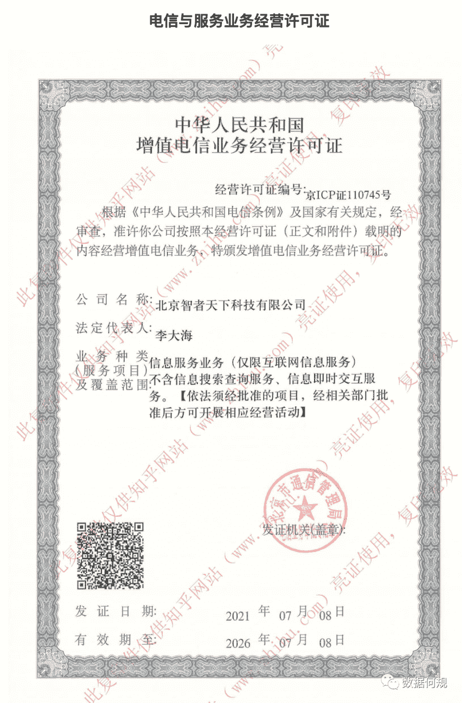

# B25牌照

> 来源：[https://docs.feishu.cn/docx/FvRhdx60YosX9XxTcm4c8uGVnYg](https://docs.feishu.cn/docx/FvRhdx60YosX9XxTcm4c8uGVnYg)

**-问：**插个楼请问各位大佬，电商网站里供用户发帖讨论商品相关问题的社区论坛，需要专门办B25牌照（信息社区服务）嘛。

**-答1：**京东

知乎

**-答2：**之前电话咨询过工信部，如果是针对单个商品下面发布评论，是不需要B25的。但如果是有专门的论坛发帖板块（不限于单件商品），就需要B25。

**-答3：**如果只是站内信，是不是也不要B25啊？

**-答4：**一般的，EDI+ICP许可就可以了。

**总结：技术上对于删除的要求，未见较**为明确的通用规定，仅金融行业有部分参考。

[牌照/资质](https://cbe8t1r4a5.feishu.cn/wiki/wikcnU29fliEy3Bopg6TKTFPLec)