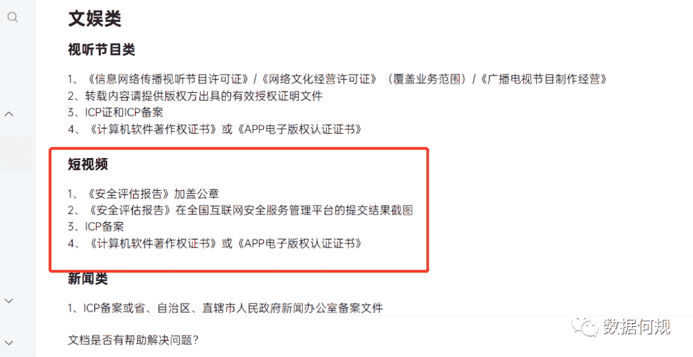
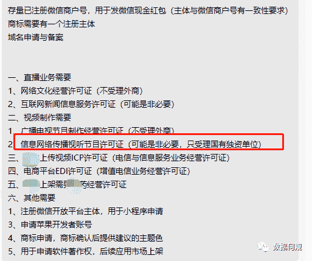
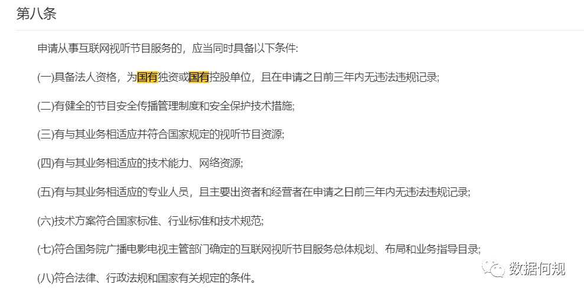

# 视听证要求

> 来源：[https://docs.feishu.cn/docx/O7Q8dlYqjoIgH7xFK4xceYh6nGg](https://docs.feishu.cn/docx/O7Q8dlYqjoIgH7xFK4xceYh6nGg)

**-问：**请教各位一个问题，APP有：

1）让用户上传视频给公众分享；

2）公司自己制作科普视频放送两项功能，业务说各大平台不需要《信息网络传播视听节目许可证》（功能1）也不用《广播电视节目制作经营许可证》（据说广电已经停放，影视剧才需要）？

以上分别是小米和OPPO的要求，但是我看《网络短视频平台管理规范》和《互联网视听节目服务管理规定》仍然有要求啊。APP有两个功能，有自己制作科普节目推送，之前有外部律师指出要广播电视证。OPPO的详细，业务认为APP属于短视频类，连用户上传视频也不需要信息网络视听许可证。

**-答1：**一个是提交截图，一个是通过。

**-答2：**《广播电视节目制作经营许可证》没问你要啊，2个平台写的一样的吧，只是一个糙了点，一个写的细化了。这个证书一般办不出来的。

**-答3：**现在一般应用商店没要求，我印象中，🛰️平台对有视频的小程序又要求，可以看看🛰️开放平台的要求。

**-答4：**刚发的文件。

> （一）从事车载网络音视频服务应取得相应许可。车载网络音视频服务机构应向广播电视主管部门申领《信息网络传播视听节目许可证》，取得车载网络音视频服务资质，向工业和信息化主管部门履行移动互联网应用程序（以下简称APP）备案手续。

> 👸号：江苏省广播电视局

> [广电总局、工信部和市场监管总局联合印](https://mp.weixin.qq.com/s?__biz=MzU2Nzc5NDE1NA==&mid=2247527232&idx=1&sn=64f11f5bb21f057e530a92bf1ab57eb2&scene=21#wechat_redirect)发《关于进一步加强车载音视频管理的通知》

**-答5：**国企可以，视听证最大的难度就是国有控股。

**-答6：**我们之前评估的是国有独资才行。

**-答7：**市面上有立法之前审批出来的证，是个人持有的，你们也可以收购，很少很少了，某大厂是这么搞定资质问题的。

**-答8：**视听传播这个证，没有国资股东就不要考虑了。我之前帮个做知识付费的客户做过评估，评估的结论是：这类政策制定时的监管对象肯定不是短视频类的经营主体，但这类主体从条文定义上会落入适用范围内。可以去看一下得到的证书，我认为它已经是在非国资背景下主体能做到的最安全范围了。。根据条文，拍摄视听作品的供应商也是要有许可的，我去问广电和电视台的人，他们说：是么？我们都是直接找合作的广告公司拍，没看过他们有没有什么资质。

**-答9：****视**听证真的是一个法律规定远远跟不上产业需要的实例，再加上广电，文旅，中宣这些年的部委权责改革，这个证成了先有鸡还是先有蛋的困境了。

**-答10：**短视频有个信息网络视听节目备案就行了吧。

**-答11：**我当时给客户的建议是去拿个“网络文化经营许可”。这个证相对来说算是最好拿的，覆盖直播和娱乐类型的短视频可以用用。

**-答12：**文网文现在某些地方还能拿，浙江这边也不好拿了。做短剧的都先拿这个证和信息网络视听证。

[牌照/资质](https://cbe8t1r4a5.feishu.cn/wiki/wikcnU29fliEy3Bopg6TKTFPLec)