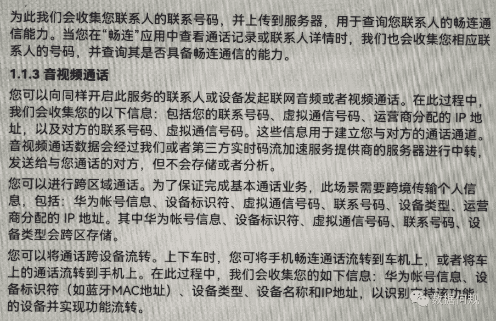

# 车外视频上云的合规性

> 来源：[https://docs.feishu.cn/docx/NZxqdO38ho5Hj2xdRazcMUFvn5O](https://docs.feishu.cn/docx/NZxqdO38ho5Hj2xdRazcMUFvn5O)

**-问：**车外视频、图像是否上云对合规风险有什么影响吗？前提是整车厂不对数据做任何处理，也访问不了数据。为什么问界的畅连里实时视频通话功能，另一端的用户可以看到实时的车外图像（涉及到车外图像，华为的做法是对车外数据仅提供中转，不做存储、分析），所以理论上华为是不是可以不算汽车数据处理者？但是哨兵模式、理想的驻车拍照，同样是涉及到车外视频图像，各车厂却要做到匿名化或者视频放在车端本地才合规呢，按理来说和问界不是一样的吗。我只做技术中转，不算汽车数据处理者啊，为什么要遵从匿名化的要求。

**-答1：**应该用的是声网的SDK，这个功能华为是应该没有接触到音视频的

**-追问：**华为的畅连和各车厂的哨兵模式，同样涉及到车外实时图像，却执行两套合规策略呢？

**-答2：**得看一下声网SDK的实现逻辑，如果是直流，确实没有任何缓存，我觉得还好，但是如果是想通过转嫁给第三方是不太可以的，得看二者主体关系，接入方依然是有责任的。

**-答3：**如果是直流的话，针对另一端可以实时看到车端的车外图像，还有和哨兵模式一样的监管风险吗？

**-答4：**有这个可能性，但是实质上的合规风险仍然没有治愈，主要是车外人脸的未经同意问题。法规要求车内处理，其实可以理解为法定豁免。从我的视角来说还是不能免除责任的，应该声网有责任进行数据处理，华为也有相应的责任。

**-追问：**手机和手机实时视频，其实也是涉及到同样的隐私问题，没有监管要求手机厂商做匿名化，为什么放到车端的实时视频，如果不匿名化，就有监管风险了呢？

**-答5：**因为场景频率的问题，外向摄像头是汽车常开的，但是手机实时语音或录制外界信息其实相对来说频率没那么高。要求是一致的，原则上应该都要获得同意的，车这边监管直接给了你解决方案，车内处理。

**-答6：**等下......问界的畅连实时视频通话功能应该是 车内 音视频交互吧？

**-答7：**可以转换摄像头，变成外向的，则有了车外数据

**-答8：**那看来车外数据只有本地或者匿名化两条路可以完全规避风险了。

**-答9：**我们说的征信，大名应该是金融信用信息吧。个人征信走许可，企业征信走备案。

**-答10：**企我理解如果直接通过wifi，u盘传给用户自己是可以，上企业云应该不行。

**-答11：**这蓝牙WIFI等车主自行近端传输和后装市场暂时不是监管关注的范围，涉及车机端-云侧-手机端的数据处理才是重点关注。

[汽车](https://cbe8t1r4a5.feishu.cn/wiki/wikcnMcafyXR4VywEcADdZAYj1b)

[匿名化](https://cbe8t1r4a5.feishu.cn/wiki/wikcn8Uugy358llBp1mB46bCJ8b)

[云服务/SaaS服务](https://cbe8t1r4a5.feishu.cn/wiki/ZlXgwXzE1iJf6lkwwdgc61R2njb)