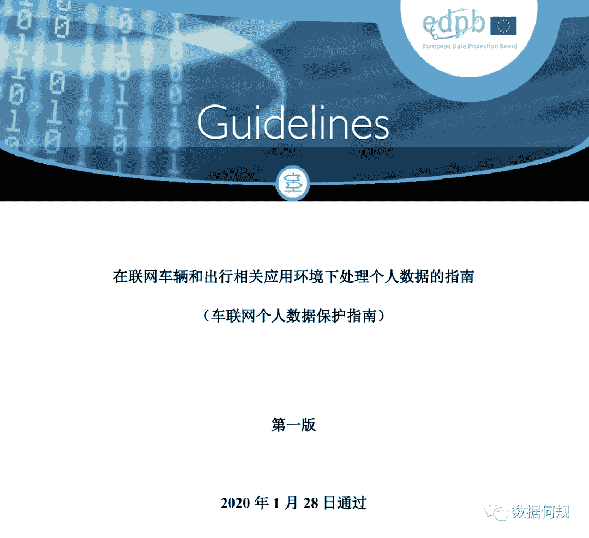

# 欧盟车企处理个人数据受的约束

> 来源：[https://docs.feishu.cn/docx/No7odEgV3oBL64xd8becRXwHnNc](https://docs.feishu.cn/docx/No7odEgV3oBL64xd8becRXwHnNc)

**-问：**欧盟针对生物特征识别信息，除了GDPR的规制，针对车企还有额外的强制性要求吗，如非必要出车？

**-答1：**EDPB指引，关于在车联网和交通相关应用程序场景中处理个人数据的指南。

**-答2：**《车联网个人数据保护指南2.0》。

[汽车](https://cbe8t1r4a5.feishu.cn/wiki/wikcnMcafyXR4VywEcADdZAYj1b)