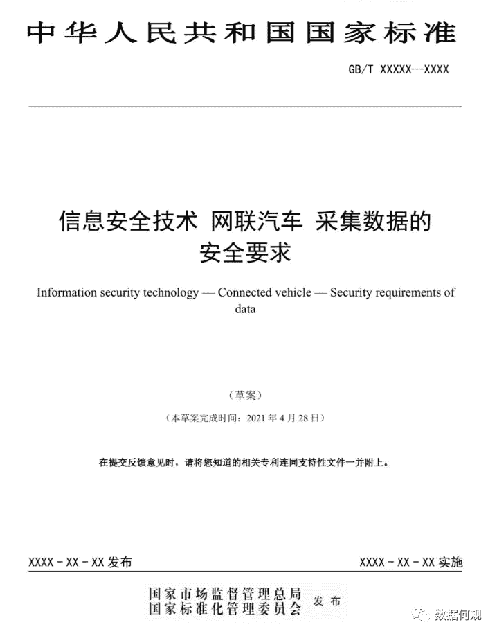
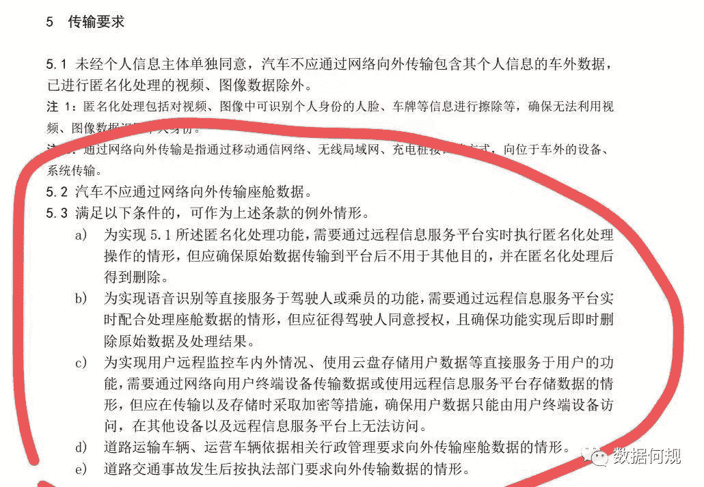

# 行车记录仪的车外匿名化

> 来源：[https://docs.feishu.cn/docx/OeiqdoH3XornIjxRbp3c8Jshnye](https://docs.feishu.cn/docx/OeiqdoH3XornIjxRbp3c8Jshnye)

**-问：**网约车运营公司为了处理交通纠纷，在自有运营车辆上（非加盟）加装行车记录仪，在事故发生时，会将发生事故时的片段上传至网约车运营公司后台，用于运营公司提供给交警进行纠纷判定。想问下这种情况需要履行车外匿名化要求么？之前查了部分国家对于行车记录仪，如果是私人安装，为了证据使用目的是可以提供法庭的 。

**-答1：**我感觉也要遵守吧，不是有个要求，前后多少秒。个人和网约车公司性质还是不太一样，感觉还是不行。特斯拉就是把行车记录仪做成个人的。

**-答2：**这种情形下，个人不论，因为不是汽车数据处理者。如果是网约车公司（可能受到规制的话），应该属于在交通领域依据相关法律法规遵守监管机构的要求而履行道路安全相关的法定义务，既属‘’免于告知-同意‘’的法律基础，也属于‘’车内处理‘’原则的例外。具体可以见《汽车采集数据处理指南》，其中几条的规定应该算是对个保法下其他法律基础的扩展和解释。

**-答3：**我觉得也应该分场景，比如实名认证场景，应该也是A提供了查询要素，在B系统去查询，也存在委托处理的可能性？

**-答4：**这个指南不是被41871替代了么？我看没有例外。

**-答5：**有部分，为了行车安全，但交通事故感觉还是有点难。

**-答6：**代替？两个文件都是参考性质。

**-答7：**还是要遵守这个未发布的国标，比如保存期限。tc260是14天，这个7天，实际应该还是按照7天。

**-答8：**41871的归口单位也是信安标委 这个文件发布在采集指南后，又出现了不一样的表述 是不是可以理解为车外数据出车没有例外要求了？

**-答9：**采集要求是41871的前身，所以肯定适用41871啊。

**总结**：行车记录仪车外人像出车匿名化是为了保护行人的个人信息权益及隐私，而车企为了达到这个要求需要付出巨大算力。但如果只是在交通事故时出车是否有例外情况，目前观点不一。个人倾向于可以豁免。

[汽车](https://cbe8t1r4a5.feishu.cn/wiki/wikcnMcafyXR4VywEcADdZAYj1b)

[匿名化](https://cbe8t1r4a5.feishu.cn/wiki/wikcn8Uugy358llBp1mB46bCJ8b)