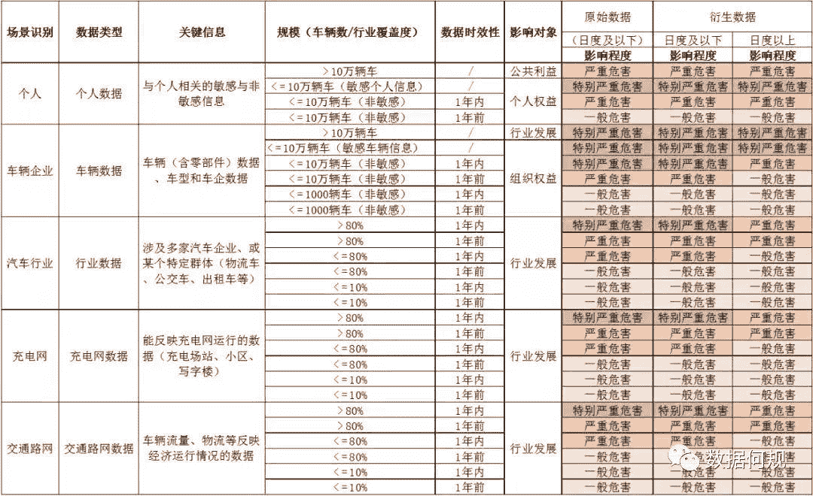
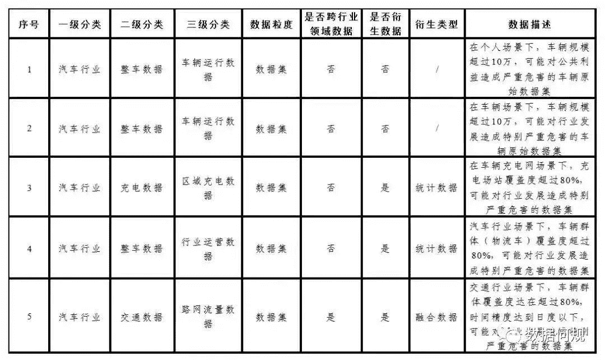

# 汽车重要数据

> 来源：[https://docs.feishu.cn/docx/PCOtdM3a7on7tOxP20AcAn18nig](https://docs.feishu.cn/docx/PCOtdM3a7on7tOxP20AcAn18nig)

**-问：**请教各位大佬。根据《汽车数据安全管理若干规定（试行）》，涉及个人信息主体超过10万人的个人信息构成重要数据。那如果公司内部自己发现超过10万了，目前实践中要主动向监管部门报送风险评估报告吗？

> 第十条 汽车数据处理者开展重要数据处理活动，应当按照规定开展风险评估，并向省、自治区、直辖市网信部门和有关部门报送风险评估报告。风险评估报告应当包括处理的重要数据的种类、数量、范围、保存地点与期限、使用方式，开展数据处理活动情况以及是否向第三方提供，面临的数据安全风险及其应对措施等。

> 《汽车数据安全管理若干规定（试行）》

**-答1：**汽车报了2年了。上海江苏重要数据识别里面也要报。

**-答2：**汽车年报里会有的 会需要你填写汽车数据总规模多少GB，涉及多少自然人。

**-追问：**什么样的公司要做汽车年报，除了整车厂？

**-答3：**7号令里都有。

> 第十三条 汽车数据处理者开展重要数据处理活动，应当在每年十二月十五日前向省、自治区、直辖市网信部门和有关部门报送以下年度汽车数据安全管理情况：

> （一）汽车数据安全管理负责人、用户权益事务联系人的姓名和联系方式；

> （二）处理汽车数据的种类、规模、目的和必要性；

> （三）汽车数据的安全防护和管理措施，包括保存地点、期限等；

> （四）向境内第三方提供汽车数据情况；

> （五）汽车数据安全事件和处置情况；

> （六）汽车数据相关的用户投诉和处理情况；

> （七）国家网信部门会同国务院工业和信息化、公安、交通运输等有关部门明确的其他汽车数据安全管理情况。

> 《汽车数据安全管理若干规定（试行）》

> 汽车数据处理者，是指开展汽车数据处理活动的组织，包括汽车制造商、零部件和软件供应商、经销商、维修机构以及出行服务企业等。

> 《汽车数据安全管理若干规定（试行）》

**-答4：**汽车行业的重要数据相关定义可参考的文件还是比较多，希望其他行业主管部门多多学习。

> 重要数据是指一旦遭到篡改、破坏、泄露或者非法获取、非法利用，可能危害国家安全、公共利益或者个人、组织合法权益的数据，包括：

> （一）军事管理区、国防科工单位以及县级以上党政机关等重要敏感区域的地理信息、人员流量、车辆流量等数据；

> （二）车辆流量、物流等反映经济运行情况的数据；

> （三）汽车充电网的运行数据；

> （四）包含人脸信息、车牌信息等的车外视频、图像数据；

> （五）涉及个人信息主体超过10万人的个人信息；

> （六）国家网信部门和国务院发展改革、工业和信息化、公安、交通运输等有关部门确定的其他可能危害国家安全、公共利益或者个人、组织合法权益的数据。

> 《汽车数据安全管理若干规定（试行）》

还有[《重要数据识别规则》——汽车](https://mp.weixin.qq.com/s?__biz=MzI1MDE2OTEyNQ==&mid=2651538119&idx=2&sn=e5dc473d6e0e9ad402c23a89d9065b68&scene=21#wechat_redirect)

[汽车](https://cbe8t1r4a5.feishu.cn/wiki/wikcnMcafyXR4VywEcADdZAYj1b)

[重要数据定义](https://cbe8t1r4a5.feishu.cn/wiki/wikcny4mT46JDD73jBFYLUpcrMb)