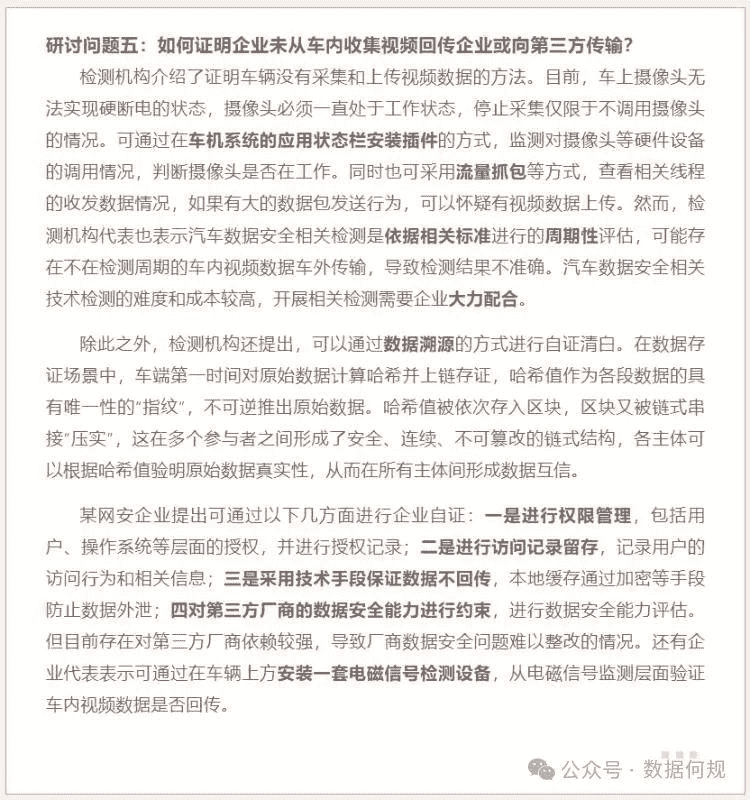
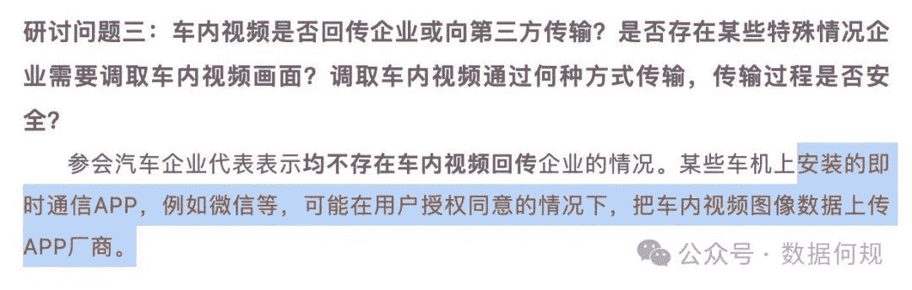

# 车内录像合规

> 来源：[https://docs.feishu.cn/docx/AzMadIls9ohYBbx0vFncdItVnNc](https://docs.feishu.cn/docx/AzMadIls9ohYBbx0vFncdItVnNc)

**-问：**[车内摄像头安全专题研讨](https://mp.weixin.qq.com/s?__biz=MzkxOTQ1NDYwNQ==&mid=2247484827&idx=1&sn=50193776c55c66ff108191f114c0a8e5&scene=21#wechat_redirect)，这篇文章挺好，回应了之前讨论过，如何证明视频没出车的问题。

**-答1：**借题想讨论下：录像传输至通信app是通过本地传输的吗？这里的不回传是指不上车厂的服务器？如果是经用户授权传输至通信app的，算不算"向车外提供"呢？

**-答2：****我粗浅的理解**1. 即时通信的视频画面是通过车内通信设施传的；2.可能既包含车企又包含App厂商，大概泛指data controller吧；3. 从41871的定义来讲，算。

-**答3：**你理解成**SDK**，但不是7号令（《汽车数据安全管理若干规定（试行）》）要管的。

**总结：无论是否涉及个人信息处理，境内从消费者保护的角度出发，也**是不合适的。监管力量未覆盖，不代表合规。

[汽车](https://cbe8t1r4a5.feishu.cn/wiki/wikcnMcafyXR4VywEcADdZAYj1b)