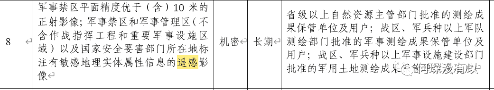

# 遥感卫星数据可以买卖吗

> 来源：[https://docs.feishu.cn/docx/MCakdNsl6o3zngxjoo3cBnwInde](https://docs.feishu.cn/docx/MCakdNsl6o3zngxjoo3cBnwInde)

**-问**：有群内大佬了解过“中国科学院遥感与数字地球研究所”吗？（网址：ceode.cas.cn）有遥感卫星数据查询和标价，还可以下单购买，不应该构成重要数据了吗？

**-答1：****这块**应该是**归测绘成**果有关规定来管理的，如果达到一定精度会构成重要数据（根据此前重要数据的国标，但没说精度是多少），另外测绘法律法规里对于属于国家秘密的测绘成果也有范围划分，可以公开购买的应该都是脱敏不涉密的，一些浅见。

根据《测绘成果管理条例》，下列测绘成果为基础测绘成果：

（一）为建立全国统一的测绘基准和测绘系统进行的天文测量、三角测量、水准测量、卫星大地测量、重力测量所获取的数据、图件；

（二）基础航空摄影所获取的数据、影像资料；

（三）遥感卫星和其他航天飞行器对地观测所获取的基础地理信息遥感资料；

（四）国家基本比例尺地图、影像图及其数字化产品；

（五）基础地理信息系统的数据、信息等。

《基础测绘成果提供使用管理暂行办法》：提供、使用不涉及国家秘密的基础测绘成果，由测绘成果资料保管单位按照便民、高效的原则，制定相应的提供、使用办法，报同级测绘行政主管部门批准后实施。

**-追问：**ceode官网 有价格的数据产品，看了眼  是基础测绘成果的（三）    遥感卫星和其他航天飞行器对地观测所获取的基础地理信息遥感资料；关于精度，测绘领域一般精度指什么啊？经纬度？还是说精确程度，是不是能定位出“卫星发射地”的具体位置？隔行如隔山。

**-答2：**记得此前向各地自然资源部门咨询，什么标准才能构成“实景影像”（大概就是谷歌实景地图），是否必须有定位信息，得到的回复也都不太相同。

参见：2020年7月出台的：《测绘地理信息管理工作国家秘密范围的规定》及《测绘地理信息管理工作国家秘密目录》。

[测绘](https://cbe8t1r4a5.feishu.cn/wiki/wikcnwa5ggqNFKo06JcGcWvzosf)