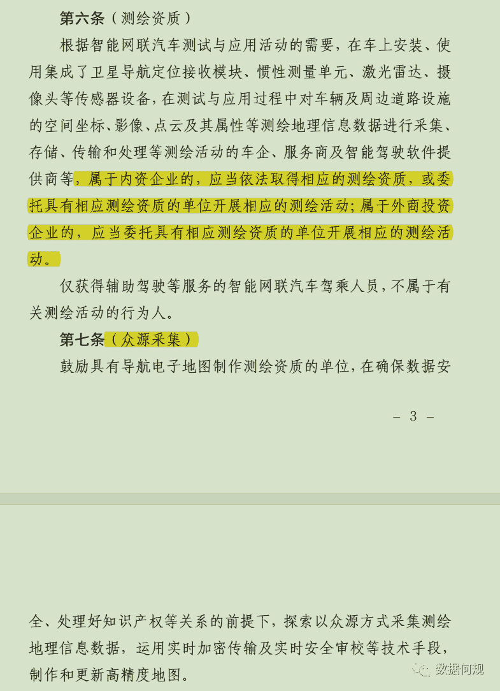

# 高精地图测绘资质

> 来源：[https://docs.feishu.cn/docx/DwIkdsBgvocz6hxOP60ccpwcnS6](https://docs.feishu.cn/docx/DwIkdsBgvocz6hxOP60ccpwcnS6)

**-问：**请教群里几位来自车企的同事，关于高精度地图测绘信息，众源采集及数据共享的问题。如上海试点规定第七条所述，有测绘资质的单位与车企合作，以众源方式采集测绘地理数据，车企本身是否就并不需要测绘资质？

**-答1：**

第六、七两条结合着看，委托有资质的测绘单位是个权宜之计。比较可行目前方案是两条脚走路：与有资质的单位签约+申请甲级资质）。

[测绘](https://cbe8t1r4a5.feishu.cn/wiki/wikcnwa5ggqNFKo06JcGcWvzosf)