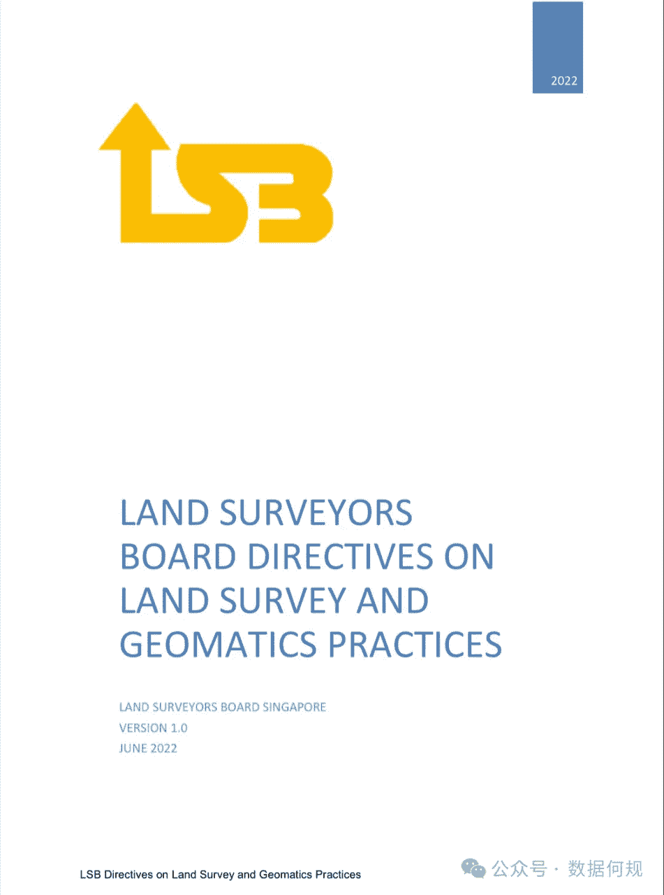
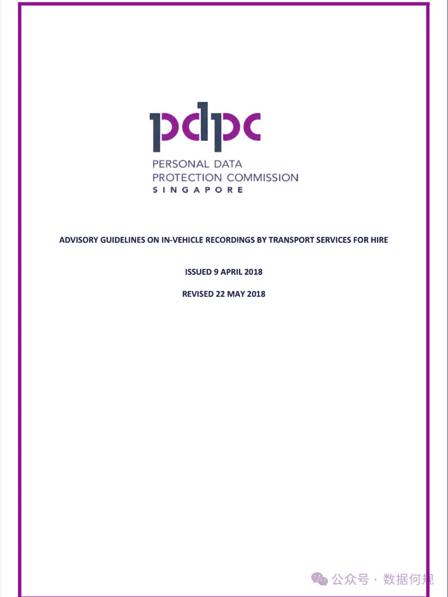
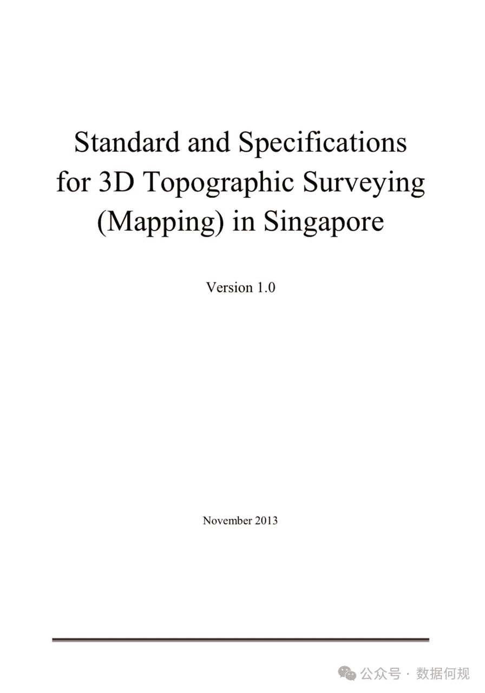

# 海外测绘法规库

> 来源：[https://docs.feishu.cn/docx/Yc4pdDu6Eo590bxFfqxcNLSunKe](https://docs.feishu.cn/docx/Yc4pdDu6Eo590bxFfqxcNLSunKe)

**-问：**有没有大佬调研过海外的测绘/地理信息数据法律法规啊，有啥好的平台/数据库吗？

**-答1：** **汤森路透**。

**-答2：**建议可以从各个国家的**政府网站和职能部门**入手看看。不过得一个个国家找，也不是个一劳永逸的办法。举个例子，新加坡，相关的可能有数据管理部门（PDPC）：https://www.pdpc.gov.sg/；土地管理部门（Land Surveyors Board, LSB）:https://lsb.mlaw.gov.sg/. 然后分别找公开的guidelines，regulations, e.g.:

**-答3：**那也得目标区域有对应的概念，和欧洲律师费老大劲让他们理解，最后全给我绕回到个人数据了。

**总结：出海不易。**

[测绘](https://cbe8t1r4a5.feishu.cn/wiki/wikcnwa5ggqNFKo06JcGcWvzosf)