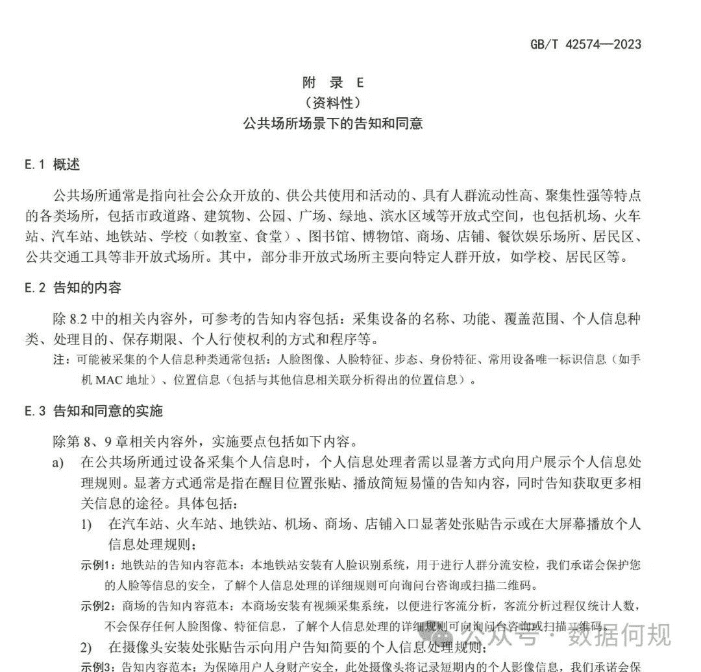
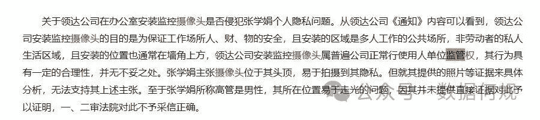
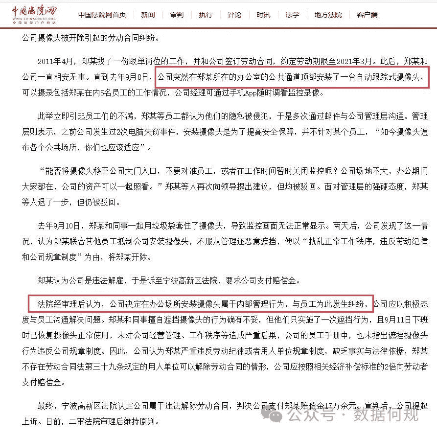
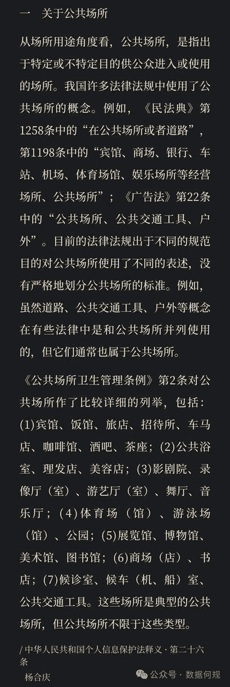

# 公共场所的认定

> 来源：[https://docs.feishu.cn/docx/GA5Jd5SDfo6DzyxmVwccJTb0nQg](https://docs.feishu.cn/docx/GA5Jd5SDfo6DzyxmVwccJTb0nQg)

**-问：**诸位大佬，请问公司的办公场所是否属于公共场所？有门禁，但是登记了就可以进。

第二十六条　在公共场所安装图像采集、个人身份识别设备，应当为维护公共安全所必需，遵守国家有关规定，并设置显著的提示标识。所收集的个人图像、身份识别信息只能用于维护公共安全的目的，不得用于其他目的；取得个人单独同意的除外。

**-答1：**可以看看**告知同意指南**。

**-答3：**补充个**裁判案例**。

翻译：公司里的摄像头清晰不够，不是为了拍你的信息，别自作多情。广东高院写的“安装的区域是多人工作的公共场所”。虽然我也不认为是公共场所。(2020)粤民申8843号。

也有一个宁波的案例，看时间是2021年审结的。

**-答4：**看看个保法**官方释义**。

**总结：对是否需要显著标识，问合规就是建议挂**，但暂时也没看到处罚。不问就当作不知道。

[生物识别信息](https://cbe8t1r4a5.feishu.cn/wiki/W4I9wH7c5iCAixkvcZ5cqmynnve)