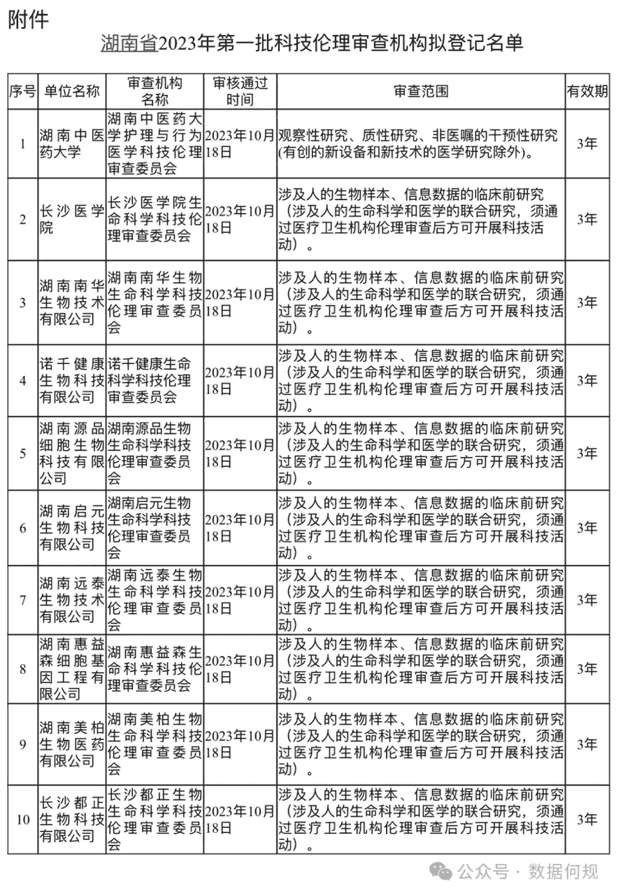

# 科技伦理委员会建设情况

> 来源：[https://docs.feishu.cn/docx/I6akdao6jopPU3xZqXccl6JKnBc](https://docs.feishu.cn/docx/I6akdao6jopPU3xZqXccl6JKnBc)

**-问：**想追问下有大佬了解科技伦理审查最新进展的么，记得之前有群友问过，比如涉及对用户生物信息或健康数据采集分析业务的，有相关企业对标审查办法第二条的“利用人类生物样本、个人信息数据等科技活动”，已启动有关评估工作的么？好像上个月上海也才要求了自行登记。

**-答1：**我这边查过，目前只有**湖南**有公布过设立了科技伦理审查委员会的公司名单，看起来是有地方牵头去搞的。

**-答2：**看下来还是药企为主，那比如像穿戴设备或健康扫描仪器这种，采集用户生物信息再分析生成健康报告的，算不算利用人类生物样本、个人信息数据的活动呢。

**-答3：**我去年问过大概7/8家跨国药企，好像都没有成立。如果有哪家成立了的同求赐教。

**-答4：****百度**：

> 11月21日晚，百度发布2023年第三季度财报，宣布正式成立科技伦理委员会，由百度集团资深副总裁、CEO助理李震宇出任委员会主席。

> 公众号：清华大学智能法治研究院[百度宣布成立科技伦理委员会](https://mp.weixin.qq.com/s/R2z6nYSayJAxRK7yepJbqA)

**-答5：**[**蚂蚁**](https://mp.weixin.qq.com/s?__biz=MjM5NTk4OTgzMA==&mid=2652397649&idx=1&sn=a5487cbe6ef74760f7483cd9da812c5c&scene=21#wechat_redirect)集团成立科技伦理顾问委员会，持续推进科技伦理建设。

**-答6：**这个网站也可以查查：https://service.most.gov.cn。

**-答7：**升级！华大科技伦理委员会正式成立。

**-答8：**也有过一个梳理。

> 在管理部门层面，湖南、山东、甘肃、辽宁、浙江、海南等多地成立了科技伦理委员会。在创新主体层面，复旦大学、清华大学、中国科学技术大学等高校，中国科学院计算技术研究所等科研机构，华大、阿里巴巴等企业，纷纷成立科技伦理（审查）委员会。

> 公众号：科普海南[夏婷：推动科技伦理治理新发展](https://mp.weixin.qq.com/s/VDdoCWy-0JUEaZ0EUn6VVg)

**-答9：**目前监管内部对审查办法第二条里利用个人数据的认定也还没形成统一口径，后续科委会与联席的行业主管部门及专家来细化，另外涉及高风险活动的认定，除了企业自行评估，科委也会关注企业在网信工信等主管部门的备案情况。

**总结：逐渐规范。**

[科技伦理](https://cbe8t1r4a5.feishu.cn/wiki/PBR2wFGRpim0Adksjy4c64PBnbd)