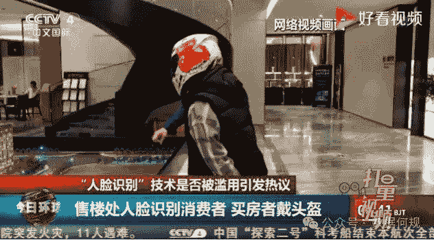
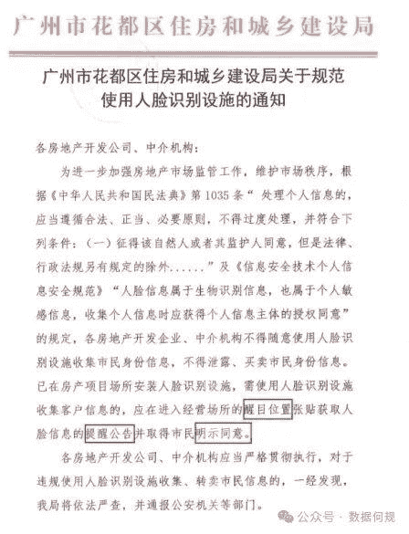

# 房地产数据合规

> 来源：[https://docs.feishu.cn/docx/WgchdaWVGo2k5pxeIrdcjcKMn0f](https://docs.feishu.cn/docx/WgchdaWVGo2k5pxeIrdcjcKMn0f)

**-问：**现在房地产行业数据合规卷吗？

**-答1：**卷啊，场景还挺多的其实各种住宅、销售、商场运营。

**-答2：**记得之前有个侵公罪的案子，是**房地产交易中心**收**集了业主**的个人信息，纸质的。然后工作人员复制了几份，卖给了其他机构。业主们不堪其扰。后来是因为诈骗还是啥的，事发了。-答4：售楼处人脸识别购买意图的事情了，还是挺典型的。

**-答5：****最开始案场人脸****识别、物**业人脸 都是率先**点名案例**吧。商管crm运营 还有 智慧楼宇什么的也有一堆问题。-答6：还有**停车场付**费。-追问：想知道目前有没有关于HR场景下使用人脸识别作为门禁管理的相关执法或者案例？我理解目前是不是只要不是作为唯一的方法，且拿到了单独同意，就是被允许的？-答7：详见：1.案例笔记：都签订人脸识别知情同意书了，还不合规？2.三家房产企业收集人脸信息，各被罚25万

**总结：房地产这个与民生息息相关的行业数据合规肯定很重要，**不过房地产企业是否经得起揉搓也是个问题。

[房地产](https://cbe8t1r4a5.feishu.cn/wiki/GYQGwk8MVims1BkKkc1cGXY2nzh)