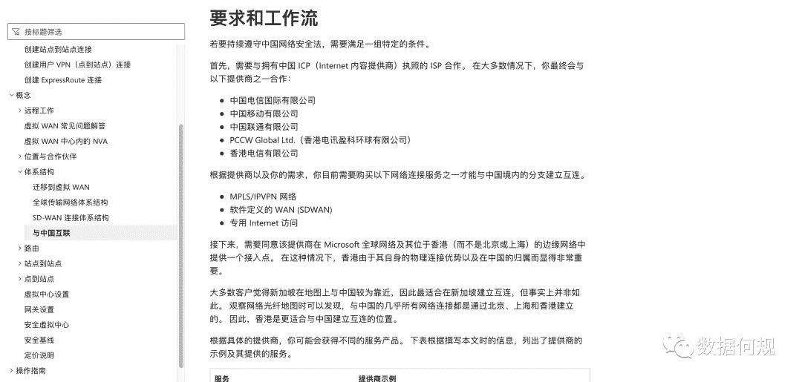

# Office服务器在香港的合规风险

> 来源：[https://docs.feishu.cn/docx/BH5TdDz9roWlSFxJKQncsE3inSd](https://docs.feishu.cn/docx/BH5TdDz9roWlSFxJKQncsE3inSd)

**-问：**请教一下各位大佬，如果邮件或者office服务器在香港，企业长期使用有没有什么风险呢，从ICP（理解香港是免备案）资质和数据出境两个角度看。

**-答1：**如达到规模，也不满足本地化存储要求？要做出境评估？

**-答2：**先苟着，通用性问题后面肯定会统一解决。

**-答3：**邮件系统（如O365）不像数据库，通常不是企业收集、存储、处理大规模用户数据的系统，而是内部办公协同工具，一般监管不会从“数据本地化”“跨境传输”方面要求企业的邮件系统数据必须存储于境内，外企的邮件系统很多都是放在境外总部的。

但如果在境内买邮件SaaS服务，通常SaaS提供商被监管要求本地化运营，如微软的O365在中国大陆的运营找的是一家大陆的合作伙伴（世纪互联）作为运营方，客户的邮件数据也存储于境内服务器中。

**-答4：**目前跟微软沟通的世纪互联他们自己有ICP，但是同时提供了一个香港版本（香港服务器也不需要备案），这个是没办法知道具体运营商是谁的，我们比较担心这种情况下会产生资质的问题，以后会不会被ban掉。

**-答5：**世纪互联的背景有啥好担心的，都是垄断的。

**-答6：**微软官网有这么一段说法，我在考虑是不是说专线的提供商在国际版本的Office中充当了世纪互联的作用。

**-答7：**还可以选择使用阿里云与钉钉，（云钉一体）更好解决安全与合规问题。

[数据出境定义](https://cbe8t1r4a5.feishu.cn/wiki/wikcn3L5bGEOvBTHYv21IniHZxc)