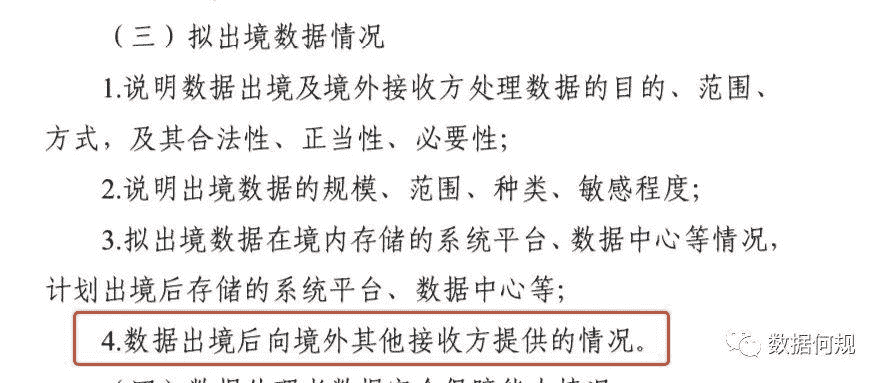

# 数据再传输的理解

> 来源：[https://docs.feishu.cn/docx/DbNvd0L7ZoxRpbxLKTYchitwnec](https://docs.feishu.cn/docx/DbNvd0L7ZoxRpbxLKTYchitwnec)

**-问：**请教各位大佬，对于数据出境自评估报告中的这一条，如果是提供给境外的接收方，接收方在集团内部的传输，是属于这一条的情形吗？这样是否构成再传输？

**-答1：**我理解如果跨法人主体就算。

**-答2：**可以直接给集团里的那个接收方吗，避免认定为再传输。

**-答3：**刚刚问了网信办，需要综合考虑系统的数量，和法人主体。

**-答4：**还要考虑系统数量？这么说一个实体内传到多个系统也可能被判定为再传输啊。

**-答5：**这个问题没有去再问。理论上一个实体要跨系统传输数据的场景倒是也不太多。如果确实有这个情况，也可以再问问网信办。

[数据出境定义](https://cbe8t1r4a5.feishu.cn/wiki/wikcn3L5bGEOvBTHYv21IniHZxc)