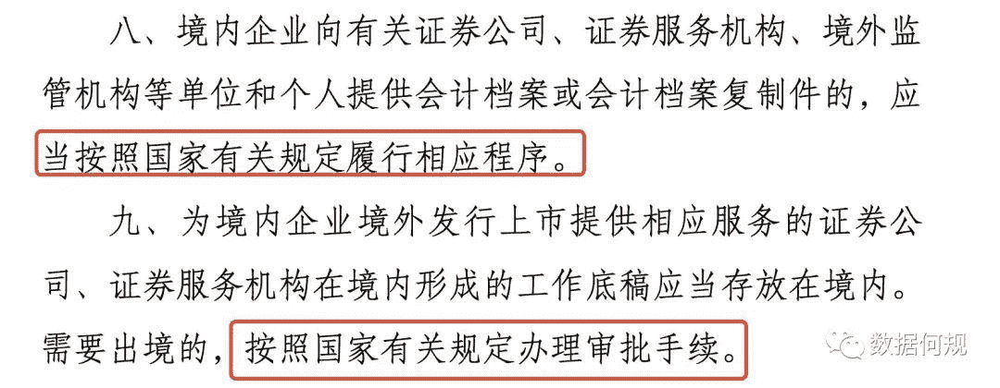
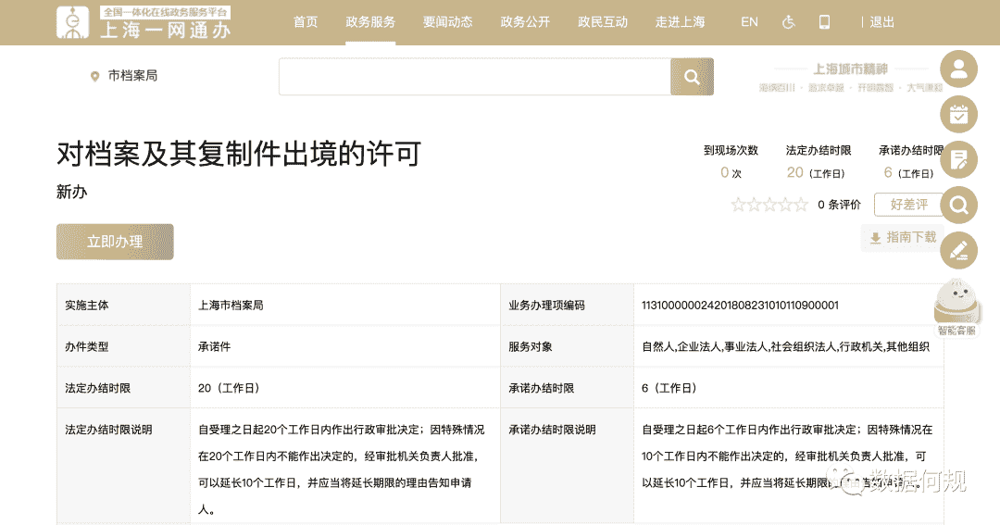

# 底稿、档案出境

> 来源：[https://docs.feishu.cn/docx/E8pFd2HWUoCRy6xtjyBcVETpnJb](https://docs.feishu.cn/docx/E8pFd2HWUoCRy6xtjyBcVETpnJb)

**-问：**请教下各位，这里的规定有特殊规定吗？

**-答1：**参考**档案法**和**会计档案管理办法**，向属地档案部门申请会计档案出境，通常工作底稿和会计档案也是高度重合的。大概的流程介绍看这里：https://zwdt.sh.gov.cn/govPortals/bsfw/item/a705df1a-0b1e-4ef3-923b-02fc3dc4738f。

[数据出境定义](https://cbe8t1r4a5.feishu.cn/wiki/wikcn3L5bGEOvBTHYv21IniHZxc)