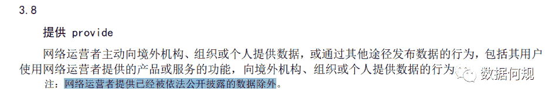

# 公开个人信息出境

> 来源：[https://docs.feishu.cn/docx/C7F0dFWUponfENxfV2Nc27Zcncq](https://docs.feishu.cn/docx/C7F0dFWUponfENxfV2Nc27Zcncq)

**-问：**请教一下，向境外提供已公开的个人信息，还需要走SCC或安全评估吗？有没有放宽的口径。我理解没有豁免，看看大家在实操中有没有遇到过绿灯。

**-答1：**没有，你公开的时候可能就触发安全评估了。

**-答2：**现在海外也不能直接访问企查查天眼查吧。

**-答3：**直接访问不就触发了，公开的数据也有重要数据，并没什么豁免。

**-答4：**仅在境内公开网页展示，境外可以通过公共网络访问，这种不属于出境。

**-答5：**很早之前的《信息安全技术 数据出境安全评估指南（征求意见稿）》，列举的不属于数据出境的情形包括：公开信息、网页被境外的机构、组织、个人访问查看的。

**-答6：**没有，**无**论是用别人家的产品（里面收集的公开信息），还是自己收集中国境内的公开信息卖给境外的客户，CAC那边都不是绿灯。

**-答7：**没准还涉及到间谍、情报、国安...etc.  更绝望了。

**总结：清晰又绝望。**

[公开](https://cbe8t1r4a5.feishu.cn/wiki/DYLZww9rMit1Plkg1rtcv351nOb)

[数据出境定义](https://cbe8t1r4a5.feishu.cn/wiki/wikcn3L5bGEOvBTHYv21IniHZxc)