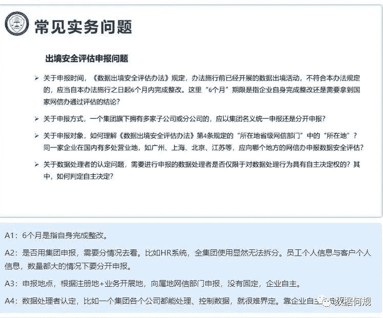

# 数据出境申报经营所在地

> 来源：[https://docs.feishu.cn/docx/OUpddqcuQoLjjexSUOOcdPLxn7g](https://docs.feishu.cn/docx/OUpddqcuQoLjjexSUOOcdPLxn7g)

**-问：**求教大家一个出境问题，总公司注册地在北京，分公司注册地在上海，上海是实际经营所在地。想问一下申报主体要选择哪里呢？属地申报这条感觉很模糊。

**-答1：**自问自答更新一下，电话咨询了某地网信办。在同一个业务场景出境下，可以合并申报，由总公司进行申报，也可以分开报。如果分公司有单个业务场景，分公司有单独申报的主体资格。

**-答2：**可之前公安三所讲座PPT供参考。

总结：统一场景集团一起报，单独场景分公司自己报。

[数据出境安全评估](https://cbe8t1r4a5.feishu.cn/wiki/wikcn3OS8YD2m6Hp8fvnw632A4d)