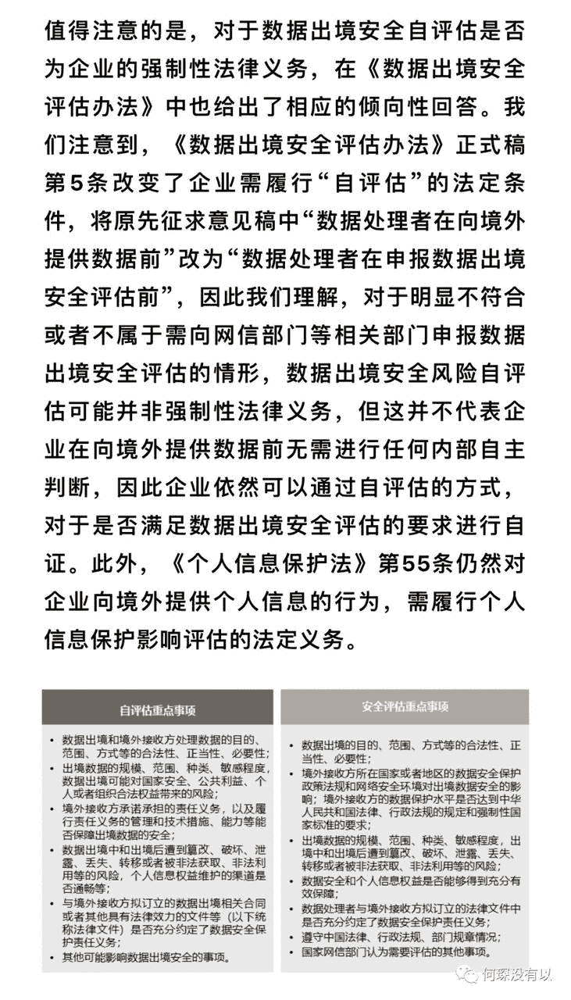

# 出境风险自评估和个人信息保护影响评估的关系

> 来源：[https://docs.feishu.cn/docx/JKA9dD0XmoTBOrxJhLick9Wqnfe](https://docs.feishu.cn/docx/JKA9dD0XmoTBOrxJhLick9Wqnfe)

**-问：**数据出境企业的风险自评估和个人信息保护影响评估是否可以划等号？自评估是否可以参照《信息安全技术 个人信息安全影响评估指南》开展？

**-答1：****金杜那**个文章分析说是不行，不过内容肯定是有重合。详见：以安全促发展——《数据出境安全评估办法》解读。

**-答2：**形式上做两个评估，内容上**PIA基本可以从自评估中摘出来**，如果出境数据含敏感个人信息，再把敏感个人信息的pia评估点也融合进去。

**-答3：**用国标范围小了。**内容有重叠**，不能直接拿PIA当自评估报告，有不一样的地方。

**-答4：**我理解是

1. 需要向网信部门申报数据出境安全评估的，才需要进行“自评估”，对于不需要申报的，个人信息的出境只需要pia

2.另外，自评估和pia并不是重复的，对于达量的个人信息出境和重要数据出境，由于可能影响到国家安全，社会公共利益，所以评估项更多。

**-答5：**我觉得只出境个人信息的话做一份就可以了，大家的观点不太一样。我觉得针对个人信息出境，个保法56条的PIA应该就长《个人信息出境标准合同规定（征求意见稿》规定的PIA那个样子就可以了，包括了56条PIA的评估内容。《个人信息出境标准合同规定（征求意见稿》规定的PIA和数据出境风险自评估，基本上只有第五项的内容是不一致的，根据实际出境的路径决定要适用哪一种。

[数据出境安全评估](https://cbe8t1r4a5.feishu.cn/wiki/wikcn3OS8YD2m6Hp8fvnw632A4d)