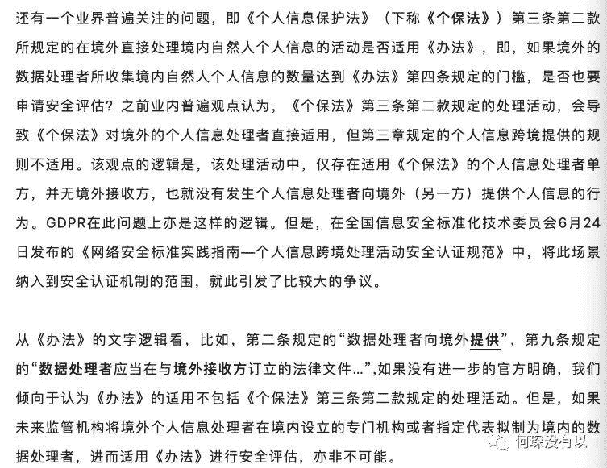

# 境外直采与出境评估

> 来源：[https://docs.feishu.cn/docx/LSSWdcpEBoFstdx6AE5cw152noh](https://docs.feishu.cn/docx/LSSWdcpEBoFstdx6AE5cw152noh)

**-问：**个保法第三条第二款的情形（境外直接收集境内个人信息）适用个保法，那达到网信部门规定数量的个人信息按照个保法应该本地化存储，然后数据出境达到安全评估的情形是不是也应该申报安全评估？不能说第三条第二款的情形适用个保法，但是不适用个保法第三章的要求吧？

**-答1：**对，这里有个困境了，那此处的**申报主体**[是这个境外处理者吗或](https://mp.weixin.qq.com/s?__biz=MzU1MzAzNzcwNw==&mid=2247484316&idx=1&sn=8432336066a943c4c142788e27dbd305&scene=21#wechat_redirect)者拟制为境内的代表处？去年就这个问题讨论过：《《个保法》的域外适用》

**-答2：**直接收集肯定**不是数据出境**，出境得有两个处理者，采集是数据主体直接到处理者。但是受个保法管辖。

**-答3：**关于境外处理者直接收集并处理境内自然人的个人信息，达100万人的，需履行何种义务：1、根据A3.2  PIPL全篇适用；2、无论是否达100万，均需增强告知-单独同意（如具备其他合法性基础，单独同意可豁免）；3、需进行数据出境安全评估，评估主体未知。因为没有境内数据处理者，只有个人信息主体；4、在境外直接响应境内个人信息主体的各项权利；5、履行第五章个人信息处理者相关义务。

猜测：1、将境内代表处拟制为境内处理者，签订合同，做评估；2、不听话，切断访问；3、未达100W，因为PIPL全篇适用，所以达到了同等保护，故无需签订标准合同或个人信息保护认证。

**-答4：**这里应该是**走认证**这条**路径吧。适用PI**PL第三条第2款，已经排除在出境安全评估以外了。关于那如果达100万了也只需要认证，我理解主要还有概念需要释明：个保法第3.2的情形，是不是能落入“向境外提供”，或者网信部会不会把这种情形列入“其他需要申报”的情形。

**-答5：**第三条第二款走认证是路径之一，但是明确说没有排除在安全评估之外，按照数据出境来讲，达到安全评估要求的只能走安全评估。

**-答6：**参见陈际红律师团队观点：《欲知平直，则必准绳——《数据出境安全评估办法》十四个焦点问题的理解》

[数据出境安全评估](https://cbe8t1r4a5.feishu.cn/wiki/wikcn3OS8YD2m6Hp8fvnw632A4d)