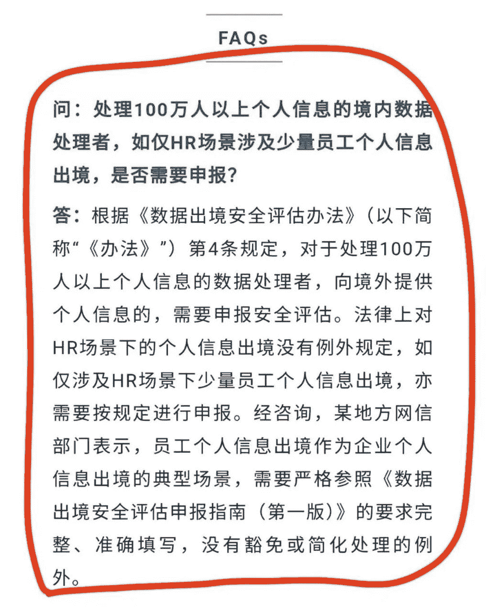

# NGO数据出境

> 来源：[https://docs.feishu.cn/docx/IPTEddQTFoAVxSxAaBJcIlwynMb](https://docs.feishu.cn/docx/IPTEddQTFoAVxSxAaBJcIlwynMb)

**-问：**请问这个问题怎么理解啊？

比如一家境外机构在境内的代表处，聘请了十个员工，相关员工个人信息报到境外总部，也需要申报吗？不知道这个百万处理个人信息怎么理解？如果是NGO资助收益群体，算吗？

**-答1：**我理解是两个维度的事情，如果这个NGO资助自然人超过100万，那么NGO员工1个员工的信息出境，也要评估。

**-追问：**这个资助数额的计算是以是否收集个人信息进行计算吗？因为公益项目动辄就是受益群体千万的。

**-答2：**就看你**是否掌握具体受资助人的信息**啊。你捐给了一个学校，需要知道每个学生的名字吗，不用吧。

**-答3：**尝试说服那些个NGO，不披露受益群体的个人信息呢？

**-答4：**部分群体可能受益了，但组织或实体也许没有处理他们的个人信息。

**-追问：**这个一百万有时间周期限制吗？

**-答5：**一般没有周期限制，这个要求主要是对于具备一定规模的个人信息处理者作出的要求。

**-答6：**可以删，**删干净**就计数减掉。

**-答7：**理论上讲，“处理”这个行为包括“删除”，这样的话，个人理解删除数据一方面在实践层面存在怎么确认完成删除动作存在困难；另一方面，删除的数量不是也累计在处理个人信息数量上吗？

**总结：100万是累积的，没有时限，境外直采达量了也应该评估。**至于如何删除是有效的删除，大不了公证吧。

[数据出境安全评估](https://cbe8t1r4a5.feishu.cn/wiki/wikcn3OS8YD2m6Hp8fvnw632A4d)